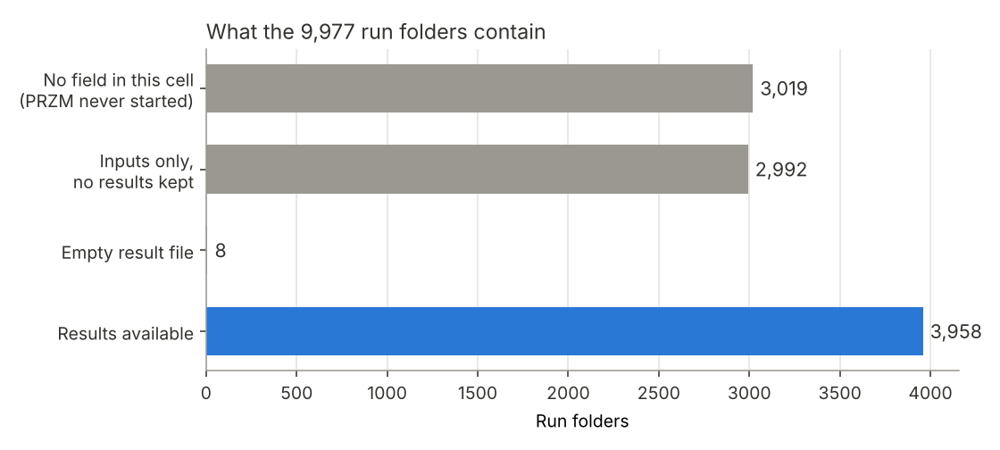
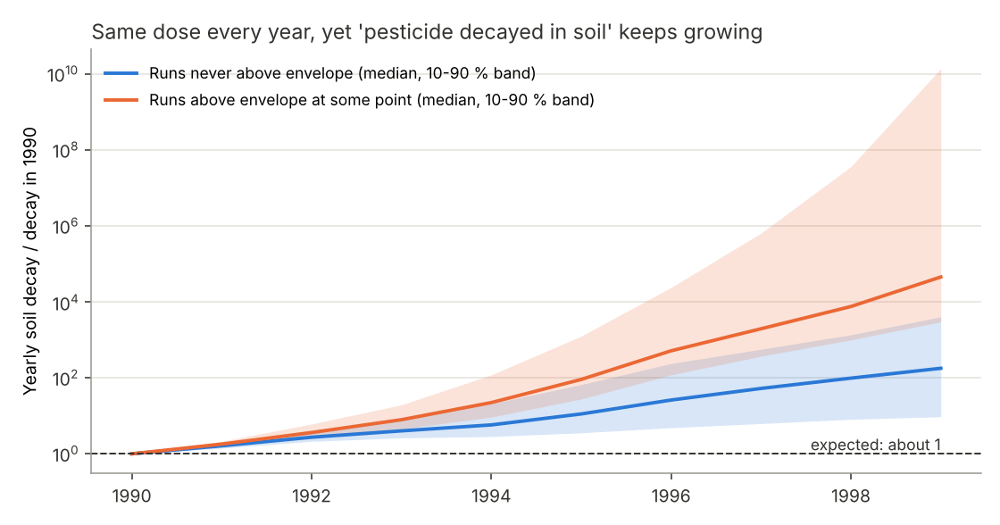
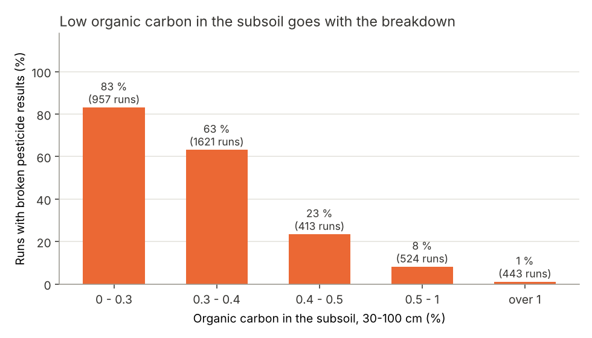
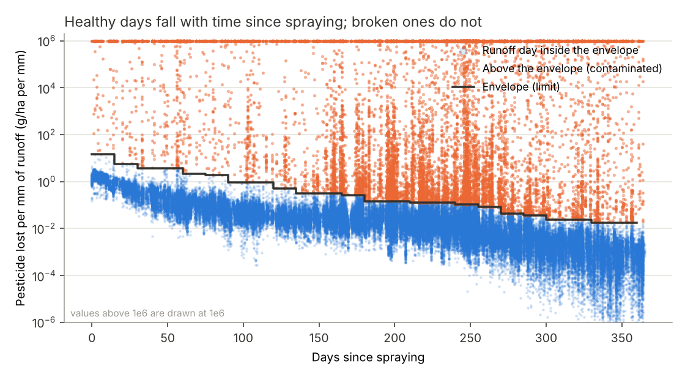
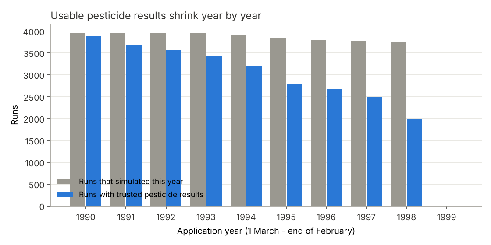

# Data report: what is in the simulation runs and what can be trusted

All numbers come from `python -m runoffwatch inventory | qc | audit` on the 10
archives from the project Drive (run on 12 Nov 2026). Machine-readable version:
[`results/quality_summary.json`](results/quality_summary.json).

## 1. What the data set contains

| | |
|---|---|
| Run folders | 9,977 |
| ... with PRZM results | **3,958** readable (+ 8 with an empty result file) |
| ... with inputs but no results kept | 2,992 |
| ... with only a log file (PRZM never started for this grid cell) | 3,019 |
| Simulated period | 1 Jan 1990 - 31 Dec 1999, daily |
| Different weather files | **695** (one weather file is shared by 1 to 77 runs) |

So the data set is about 4,000 simulations, not 10,000.

### What differs between runs

| Differs | Does **not** differ |
|---|---|
| Weather (695 files) | Pesticide: Flufenacet in every run |
| Slope (0 - 25 %), soil erodibility, slope-length factor | Dose: 2.4 kg/ha |
| Curve number (4 sets: 73 / 77 / 81 / 84) | Spray date: 1 March, every year |
| Soil per layer: bulk density, field capacity, wilting point, organic carbon (0.2 - 39 %), sand, clay | Crop: winter cereals, same dates |
| Sorption Kd (but only through organic carbon: Kd = 3.775 x OC) | Decay rate, Henry constant |

**Consequence:** the data can teach a model about *weather* and *soil*. It
cannot teach anything about *which pesticide*, *how much*, or *which spray
date*, because those never change. A tool that compares products or doses
needs new PRZM runs in which they vary.

## 2. The pesticide results are numerically broken in part of the runs

### What we see (certain: read directly from the files)

1. **Impossible losses.** Each run applies 2,400 g/ha per year. Some runs
   report up to 1.8e34 g/ha washed off. 263 runs stop before 1999 (the
   simulation crashes).
2. **"Soil decay" grows in almost every run.** The same dose is applied each
   year, so the yearly amount that decays in the soil should stay about the
   same. Instead it grows by a median factor of 2.5 per year; in 83 % of the
   runs it grows by more than 1.5x per year.
3. **`NaN` in every result file.** In all 3,958 readable `.OUT` files the
   column "GAS DIFFUSION" of the yearly pesticide table is `NaN` from the first
   year (1990) on, and later holds values like 1e17.
4. **The fake mass starts in the deep soil.** In one run we inspected that
   looks healthy at the surface, the lowest soil layer stores 7.5 kg/ha at the
   end of 1999, three times the yearly dose, while the top layer is still normal.
5. **In about half of the runs it reaches the surface** and then corrupts the
   runoff losses, which is the quantity this project is about.

### What does *not* seem affected

* **Water**: rain, runoff and erosion do not depend on the pesticide
  calculation. Rain in the weather file equals rain in the results in every run.
* **Pesticide loss in early years**: surface losses show no upward trend
  until the fake mass arrives (see the rule below).

### Likely cause (a hypothesis for the Landau group to confirm)

The broken numbers sit in the gas-diffusion term. The runs use a Henry
constant of **0.03** and an air diffusion coefficient of 4,300 cm²/day
(echoed by PRZM in each `.OUT` file). Our guess: with this high Henry constant
the vapour-phase transport calculation becomes unstable.

Supporting evidence: whether a run breaks can be predicted from its settings
almost perfectly (cross-validated AUC 0.97), and the strongest predictor is
**organic carbon in the subsoil**. Little organic carbon means little sorption,
so more pesticide is in the gas phase.

| Organic carbon, 30-100 cm | Runs | Broken at some point |
|---|---|---|
| 0 - 0.3 % | 957 | 83 % |
| 0.3 - 0.4 % | 1,621 | 63 % |
| 0.4 - 0.5 % | 413 | 24 % |
| 0.5 - 1 % | 524 | 8 % |
| over 1 % | 443 | 1 % |

## 3. How we decide what to trust (Task 1)

Quality is decided **per run and per year**, not per run.

**Envelope rule.** On a runoff day, "pesticide lost per mm of runoff water"
must fall with the days since spraying, because the pesticide decays. The
upper limit for each "days since spraying" is learned from 1990, before the
fake mass can have reached the surface (99th percentile per 15-day bin, times
5). The first day a run goes above the limit marks its first bad application
year. The year before is dropped as well, and the last simulated year is never
trusted, because a year can only be confirmed by a clean following year.

**Result**

| | |
|---|---|
| Runs that go above the envelope at some point | 1,966 of 3,958 |
| Runs that never do | 1,992 |
| Trusted pesticide data | **28,363 of 38,766 run-years (73 %)** |
| Runs with at least 3 trusted years | 3,568 |
| Trusted water (runoff) data | all 3,958 runs |

**Machine-learning second opinion.** An Isolation Forest (unsupervised
anomaly detection) on four per-run summary numbers flags 652 runs. It agrees
with the simple decay rule on 86 % of the runs but finds only 54 % of the runs
that rule calls unstable. Here the physical rule is the better detector: the
breakdown is gradual, so many broken runs do not look like outliers. That is a
result worth reporting, not a failure.

**Limit of the rule.** It finds contamination once it is about 5x above
normal. Smaller contamination just before that point is removed only by the
one-year guard. The late-season level of the kept data is flat from 1991 to
1998, which supports the rule, but this is not proof that every kept value is
exact.

## 4. Questions for the Landau group

1. Is a Henry constant of 0.03 intended for Flufenacet? (In the run we
   inspected, PRZM reports about 2.0 of the 2.4 kg/ha leaving through the air
   each year, and the gas-diffusion numbers are `NaN` from the first year.)
2. Can the runs be repeated with volatilisation switched off or with a
   realistic Henry constant? That would likely make all years usable.
3. Why do 2,992 folders have inputs but no result files?
4. Is the weather real (for example MARS/Agri4Cast grid cells) or generated?
   There are 695 different weather files, all 1990-1999.
5. Can new runs vary the spray date, the dose and the pesticide? Without that,
   no tool can compare products, doses or seasons.
6. The log of nearly every run ends with a missing-file error
   (`..._runoff_grd.tif`). Is the step after PRZM needed for anything we use?
