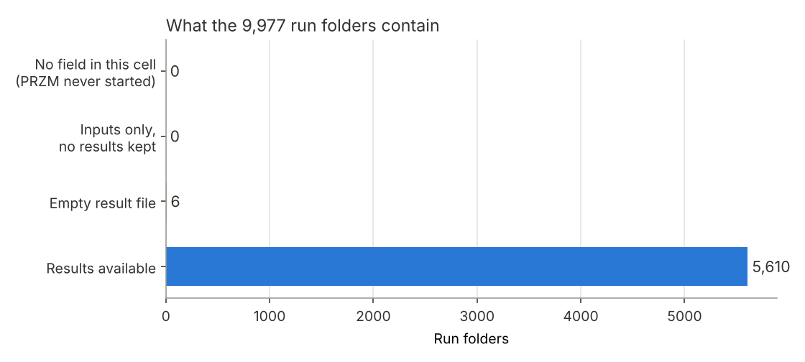
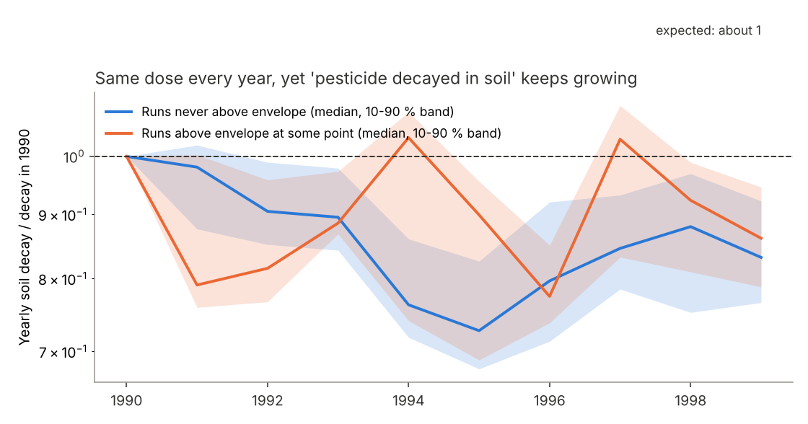
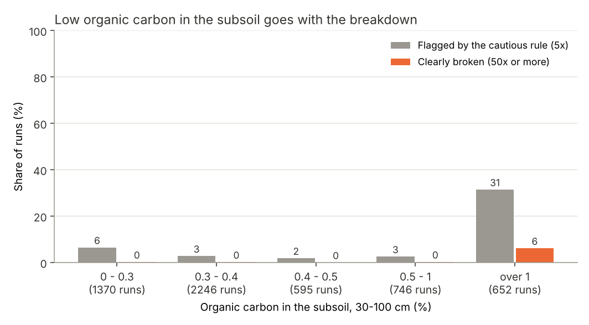
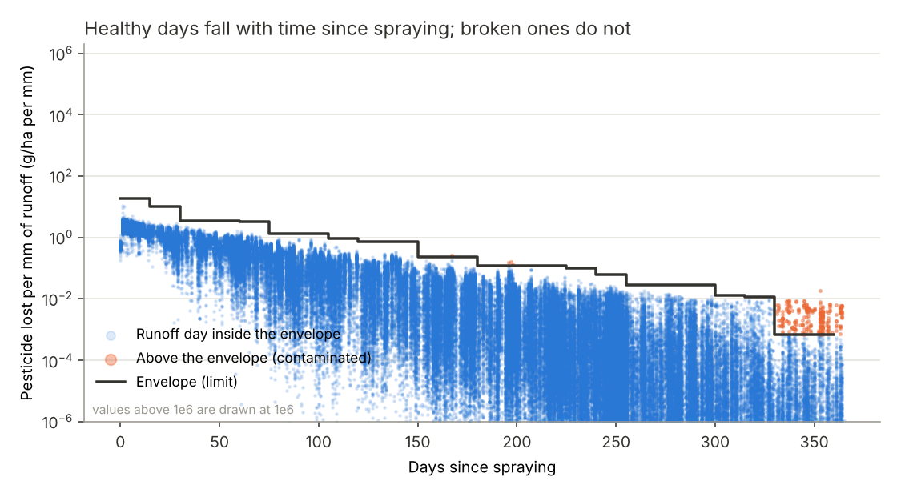
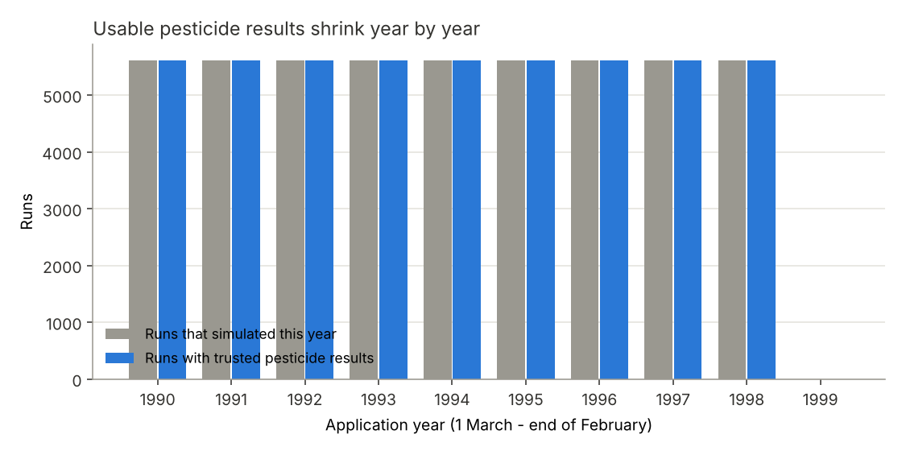

# Data report: what is in the simulation runs and what can be trusted

All numbers come from `python -m runoffwatch inventory | qc | audit` on the 10
archives from the project Drive (run on 12 Nov 2026). Machine-readable version:
[`results/quality_summary.json`](results/quality_summary.json).

## 1. What the data set contains

| | |
|---|---|
| Run folders | 9,977 |
| ... with PRZM results | **3,958** readable (+ 8 with an empty result file) |
| ... with inputs but no results kept | 2,992 |
| ... with only a log file (PRZM never started) | 3,019 |
| Simulated period | labelled 1 Jan 1990 - 31 Dec 1999, daily; the weather is really 2006 - 2015 (see below) |
| Different weather files | **695** (one weather file is shared by 1 to 77 runs) |

So the data set is about 4,000 simulations, not 10,000.

### Where the runs come from (added 17 Nov 2026, from the project cloud folder)

- **Each run is a real field in France.** The 9,977 runs are a random sample of
  9,977 real pesticide applications in France. The number in a run's name is the
  field's id; `grid_...` is the Agri4Cast weather grid cell the field lies in.
- **Soil and slope are the field's own**: soil from the European soil database
  at the field's location, slope from an elevation map of France.
- **Weather is the field's Agri4Cast grid cell.** The Agri4Cast table for
  France (1,003 grid cells, 1979-2024) contains all 695 cells used.
- **The years are mislabelled by 16.** The weather labelled 1990-1999 in the
  runs is identical, value for value, to the Agri4Cast record of **2006-2015**
  (checked for 25 fields; rain, temperature and evaporation agree exactly).
  Dates in this report and in the code keep PRZM's labels; add 16 years to get
  the real year. The storm labelled 15 August 1994 happened on 15 August 2010.
- **The real pesticides were not simulated.** The sample comes with the
  substances and doses actually applied to each field (215 substances). The
  runs nevertheless all use Flufenacet at 2.4 kg/ha on 1 March.
- **The failed runs stopped at the very start.** A separate archive holds the
  working folders of 936 failed runs. In all 200 we opened, PRZM stopped
  within the first simulated month. The cause is not known.
- **The PRZM program itself is available** to this year's students
  (`WINPRZM.exe` with one example run). New runs could therefore be made on
  any Windows computer, without the modelling workstation.

### What differs between runs

| Differs | Does **not** differ |
|---|---|
| Weather (695 files) | Pesticide: Flufenacet in every run |
| Slope (0 - 25 %), soil erodibility, slope-length factor | Dose: 2.4 kg/ha |
| Curve number (4 sets: 73 / 77 / 81 / 84) | Spray date: 1 March, every year |
| Soil per layer: bulk density, field capacity, wilting point, organic carbon (0.2 - 39 %), sand, clay | Crop: winter cereals, same dates |
| Sorption Kd (but only through organic carbon: Kd = 3.775 x OC) | Decay rate, Henry constant |

**Consequence:** the data can teach a model about *weather* and *soil*. It
cannot teach anything about *which pesticide*, *how much*, or *which spray
date*, because those never change. A tool that compares products or doses
needs new PRZM runs in which they vary.

## 2. The pesticide results are numerically broken in part of the runs

### What we see (certain: read directly from the files)

1. **Impossible losses.** Each run applies 2,400 g/ha per year. Some runs
   report up to 1.8e34 g/ha washed off. 263 runs stop before 1999 (the
   simulation crashes).
2. **"Soil decay" grows in almost every run.** The same dose is applied each
   year, so the yearly amount that decays in the soil should stay about the
   same. Instead it grows by a median factor of 2.5 per year; in 83 % of the
   runs it grows by more than 1.5x per year.
3. **`NaN` in every result file.** In all 3,958 readable `.OUT` files the
   column "GAS DIFFUSION" of the yearly pesticide table is `NaN` from the first
   year (1990) on, and later holds values like 1e17.
4. **The fake mass starts in the deep soil.** In one run we inspected that
   looks healthy at the surface, the lowest soil layer stores 7.5 kg/ha at the
   end of 1999, three times the yearly dose, while the top layer is still normal.
5. **In roughly a third to a half of the runs it reaches the surface** and then
   corrupts the runoff losses, which is the quantity this project is about.
   The share depends on how strict the test is (section 3): 1,177 runs (30 %)
   are broken beyond doubt, 1,966 (50 %) are flagged by the cautious rule.

### What does *not* seem affected

* **Water**: rain, runoff and erosion do not depend on the pesticide
  calculation. Rain in the weather file equals rain in the results in every run.
* **Pesticide loss in early years**: surface losses show no upward trend
  until the fake mass arrives (see the rule below).

### Likely cause (a hypothesis for the Landau group to confirm)

> **Update 23 Nov 2026:** this hypothesis was tested with local PRZM runs and holds. The test also
> showed that the runs we kept as "trusted" are affected. See [section 6](#6-local-re-runs-two-settings-are-wrong-23-nov-2026).

The broken numbers sit in the gas-diffusion term. The runs use a Henry
constant of **0.03** and an air diffusion coefficient of 4,300 cm²/day
(echoed by PRZM in each `.OUT` file). Our guess: with this high Henry constant
the vapour-phase transport calculation becomes unstable.

Supporting evidence: whether a run gets flagged can be predicted from its
settings almost perfectly (cross-validated AUC 0.97), and the strongest
predictor is **organic carbon in the subsoil**. Little organic carbon means
little sorption, so more pesticide is in the gas phase.

| Organic carbon, 30-100 cm | Runs | Flagged by the cautious rule | Clearly broken |
|---|---|---|---|
| 0 - 0.3 % | 957 | 83 % | 68 % |
| 0.3 - 0.4 % | 1,621 | 63 % | 31 % |
| 0.4 - 0.5 % | 413 | 24 % | 6 % |
| 0.5 - 1 % | 524 | 8 % | 1 % |
| over 1 % | 443 | 1 % | 0 % |

The trend is the same under both definitions; the size of the middle classes is not.

## 3. How we decide what to trust (Task 1)

Quality is decided **per run and per year**, not per run.

**Envelope rule.** On a runoff day, "pesticide lost per mm of runoff water"
must fall with the days since spraying, because the pesticide decays. The
upper limit for each "days since spraying" is learned from 1990, before the
fake mass can have reached the surface (99th percentile per 15-day bin, times
5). The first day a run goes above the limit marks its first bad application
year. The year before is dropped as well, and the last simulated year is never
trusted, because a year can only be confirmed by a clean following year.

**Result**

| | |
|---|---|
| Runs flagged by the rule (more than 5x above the 1990 limit) | 1,966 of 3,958 |
| Runs that never are | 1,992 |
| Trusted pesticide data | **27,730 of 38,100 run-years (73 %)** |
| Trusted water (runoff) data | all 3,958 runs |

**The rule is cautious on purpose, and the count depends on the factor.**
There is no sharp gap between healthy and broken runs:

| Run goes above the 1990 limit by more than | 5x (rule used) | 10x | 50x | 1000x |
|---|---|---|---|---|
| Runs | 1,966 | 1,648 | 1,177 | 825 |

About half of the flagged runs are only 2x over the flagging limit in their
first flagged year, and some of those never exceed it again. 1990 is also a
slightly low reference year (little pesticide is carried over from before).
So "1,966 broken runs" would overstate it. The safe statements are: **1,177
runs (30 %) are broken beyond doubt** (50x or more; the older "soil decay"
rule finds 1,145), and the rule removes another 789 runs' later years as a
precaution. That precaution costs about 7 % of the data. An independent review
estimated its effect on the model scores as small (a few percent of the
high-loss days and of the loss in the test set).

**Machine-learning comparison.** An Isolation Forest (unsupervised anomaly
detection) on four per-run summary numbers flags 652 runs. It finds only 52 %
of the 1,177 clearly broken runs and 31 % of all flagged runs. (It is not an
independent check: two of its four inputs are the numbers the decay rule is
built on.) Here the physical rule is the better detector: the breakdown is
gradual, so many broken runs do not look like outliers. That is a result worth
reporting, not a failure.

**Limit of the rule.** It finds contamination once it is about 5x above
normal. Smaller contamination just before that point is removed only by the
one-year guard. The late-season level of the kept data is flat from 1991 to
1998, which supports the rule, but this is not proof that every kept value is
exact.

## 4. What the project documentation added (16 Nov 2026)

The technical notes of the modelling group answered some of our questions:

- **The weather is Agri4Cast.** The weather files are grid cells of the JRC
  "Gridded Daily Agro-Meteorological Data in Europe" (MARS). So the 695
  weather files are real, measured-and-interpolated weather, not generated.
- **Volatilisation is confirmed by the earlier group's own table**: for the
  first run it lists 1.82 of the 2.4 kg/ha leaving through the air in the
  first year.
- **The Henry constant 0.03 is the template value.** The example run file in
  the notes, written for a different pesticide, has the same Henry constant,
  the same dose and the same spray date as our runs. It was most likely never
  chosen for Flufenacet. This supports the hypothesis in section 2.
- **Each run is defined by a small parameter file**, and about 30 settings
  can be varied, including substance properties and dose. New runs are
  possible ([NEW_RUNS_PLAN.md](NEW_RUNS_PLAN.md)).
- **The spray date is fixed in the model configuration** ("03-01"), not read
  from the run file. That is why it never varies.

## 5. Questions for the Landau group

1. Is a Henry constant of 0.03 intended for Flufenacet, or is it the template
   default? Our local test runs (section 6) show that it causes the broken numbers and that a
   realistic value removes them.
1b. Is the reference soil moisture of 100 read by this PRZM version as a fraction? With 100 the
   pesticide decays about 25 times too slowly in our test runs; with 1 it behaves as expected.
2. May we submit our own runs? A design is prepared: 200 control runs that
   change only the Henry constant, and 2,000 runs with varied spray date, dose,
   half-life and sorption.
3. Can the model configuration read the spray date from the run file?
4. Why do 2,992 runs stop within the first simulated month?
5. The log of nearly every run ends with a missing-file error
   (`..._runoff_grd.tif`). Is the step after PRZM needed for anything we use?
6. Why were the real substances and doses of the sampled fields not used, and is the 16-year
   shift of the weather labels intended?

## 6. Local re-runs: two settings are wrong (23 Nov 2026)

The PRZM program (`WINPRZM.exe`) from this year's project folder runs on an ordinary Windows
computer in about 3 seconds per field. We used it for two small tests: 30 runs in total, on six
fields from the data set (three clearly broken, one that crashed, two that pass our check; the two
passing ones turned out to have identical inputs) plus the example run that comes with the program.
All numbers are in [`results/local_rerun_tests.csv`](results/local_rerun_tests.csv).

### Test 1: the Henry constant (21 runs)

Each field was run three times. Only the Henry constant differs.

| Field | Henry 0.03 (as delivered) | Henry 3.7e-7 | Henry 0 |
|---|---|---|---|
| broken 1 | 1.2e15 g/ha lost in ten years | 37 g/ha | 37 g/ha |
| broken 2 | 1.7e9 g/ha | 39 g/ha | 39 g/ha |
| broken 3 | 7.2e10 g/ha | 46 g/ha | 46 g/ha |
| crashed | stops on day 1,344 | all ten years, 174 g/ha | 174 g/ha |
| passes our check | 22 g/ha | 62 g/ha | 62 g/ha |
| program's example | 36 g/ha | 35 g/ha | 35 g/ha |

What this shows:

- **The local program gives exactly the delivered numbers.** With Henry 0.03, all six fields from
  the data set reproduce the stored daily losses, including the crash on day 1,344. So the fault
  does not come from the modelling workstation.
- **The Henry constant causes the explosion.** With a small value every run finishes, and PRZM's
  own pesticide balance error drops from up to 1e19 to about 1e-7.
- **The runs that pass our check are affected too.** With Henry 0.03, PRZM lets 65-80 % of every
  dose evaporate (1.5 to 2 of 2.4 kg/ha per year). With a small value almost nothing evaporates and
  the loss with runoff is about three times higher. Even in these runs the balance error grows
  from year to year.
- **The `NaN` values are not the fault.** They stay in the "gas diffusion" column after the fix.
  They are a printing problem in that column, not a sign of a broken run.
- A realistic value and zero give the same result, so the exact small number does not matter.

Is 0.03 wrong for Flufenacet? Published Henry's law constants are about 0.0006 to 0.0013 Pa m³/mol,
which is 2.4e-7 to 5.3e-7 as the dimensionless number PRZM uses. That makes 0.03 about 100,000
times too high. (These values were taken from search results for the PPDB and PubChem entries; the
pages themselves could not be opened from our environment, so they should be checked once more.)
The example run that comes with the program is labelled "Lindane" and uses the same 0.03, which
suggests it is a template value.

### Test 2: why the pesticide piles up in the soil (9 runs)

With the Henry constant fixed, a second problem became visible. The input says half of the
pesticide decays in 42 days, yet about four yearly doses (9 to 10 kg/ha) are still in the soil
after ten years. Three fields were run again, each time with one decay setting changed.

| Setting changed | Pesticide in the soil after ten years | Ten-year loss with runoff (field that passes our check) |
|---|---|---|
| none (Henry fixed only) | 9.1 to 13.8 kg/ha | 62 g/ha |
| moisture correction switched off (exponent 0) | 0.02 to 1.4 kg/ha | 30 g/ha |
| reference moisture 1 instead of 100 | 0.06 to 1.9 kg/ha | 33 g/ha |
| temperature correction switched off (Q10 = 1) | 6.9 to 12.1 kg/ha | 62 g/ha |

(The higher end of each range is the program's example run, whose decay rate is 3.5 times lower.)

The moisture correction slows decay in dry soil: rate × (moisture / reference moisture)^0.7. The
input files give the reference as 100, meant as 100 % of field capacity. The results fit this
program working with moisture as a fraction, where field capacity is 1: then 100 makes decay
100^0.7 = 25 times slower, which is the size of the effect we see. We cannot tell from outside
whether the input or the program is at fault. The practical fix is the same: reference moisture 1.

### What follows

- The delivered pesticide results are wrong for all runs, not only for the ones our check removes.
  In the passing runs two errors work against each other (too much evaporation, too little decay).
- The water results (rain, runoff, infiltration) do not depend on these settings and stay valid.
- All results in `MODEL_REPORT.md` were learned from the delivered data. The methods stay; the
  numbers have to be redone on corrected simulations.
- Corrected simulations can be made locally: 6,958 folders have input files (the 3,958 with
  results plus 2,992 that stopped early and 8 with empty results), and the editor works on 6,945 of them (13 input files are
  damaged). `python -m runoffwatch rerun` does this; see the README.
- Both corrections are our reading of the evidence. The model owners should confirm them.
