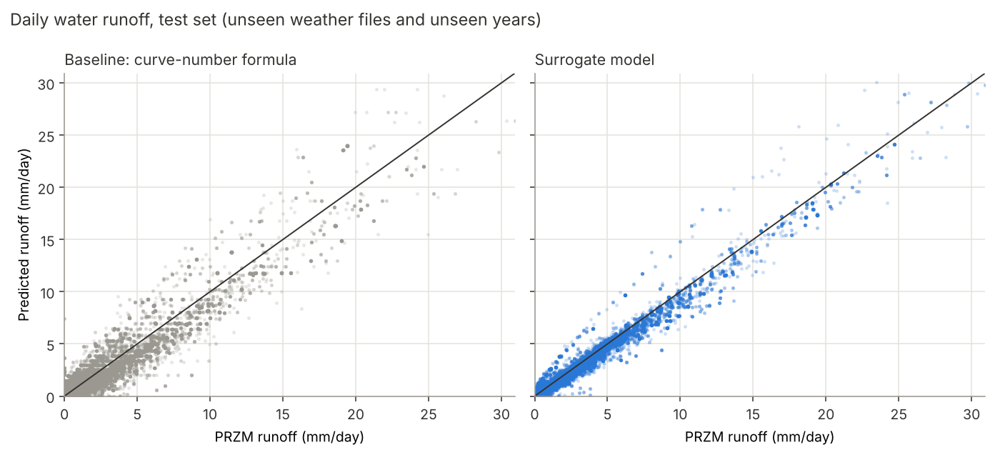
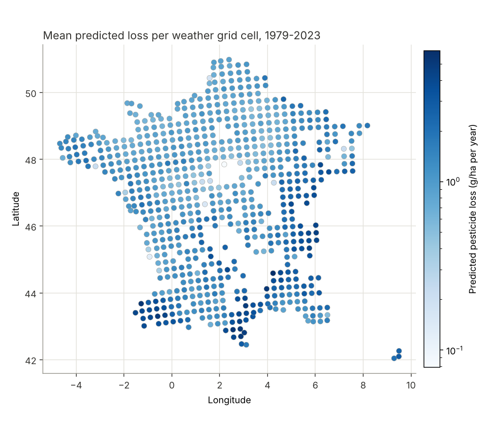
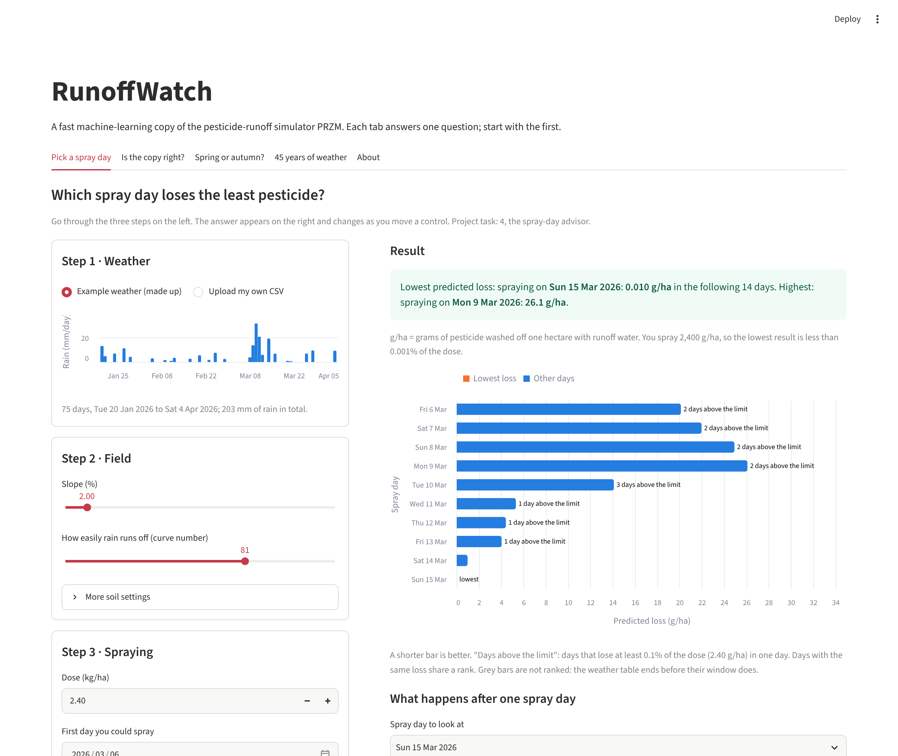

# Model report: surrogate of PRZM, high-loss days, spray-day advisor

All numbers are from `python -m runoffwatch train --cv` (leave-one-year-out) and
`python -m runoffwatch train` (final models, figures) on 16 Nov 2026; the LSTM comparison is in
[`results/lstm_vs_trees.json`](results/lstm_vs_trees.json). Machine-readable:
[`results/cv_summary.json`](results/cv_summary.json), [`results/cv_by_year.csv`](results/cv_by_year.csv),
[`results/model_metrics.json`](results/model_metrics.json).
Which data went in: [DATA_REPORT.md](DATA_REPORT.md).

## 1. What was built

**Surrogate of PRZM** in two stages that follow the physics:

| Stage | Input | Output | Trained on |
|---|---|---|---|
| Runoff model | today's rain, rain and temperature of the days before, evaporation, curve number, soil | mm of water running off | all 3,958 runs |
| Concentration model | days since spraying, rain and temperature since spraying, soil | g/ha of pesticide per mm of runoff | only run-years that passed the quality audit |

Pesticide loss = runoff x concentration. No PRZM output is used as an input.

Both are gradient-boosted trees (LightGBM). The runoff model is
**physics-informed**: the textbook curve-number runoff for today's rain is one
of its inputs, so it only has to learn how PRZM corrects that for soil moisture.

The concentration model is trained on the amount itself, with each day weighted
by its runoff, so that errors are counted in grams lost. The first version was
trained on the logarithm of the amount; it was very exact for small losses but
underestimated the large ones (section 3).

The models saved in `models/` and used by the advisor are trained on **all
years and all weather files**. Their expected accuracy is the leave-one-year-out
score below; they cannot be tested themselves because no data is left over.

**High-loss classifier**: is today a day with at least 1 g/ha pesticide loss
(0.04 % of the dose)? Such days are 0.17 % of all rain days and carry 55 % of
the pesticide loss. It turned out to be the weaker of the two ways to find such
days (section 3) and is kept for comparison and for the driver ranking.

## 2. How it was tested, and a mistake worth knowing about

**Leave one year out.** For each application year from 1990 to 1998 in turn,
the models are trained without that year and tested on it, using only weather
files that were also kept out of training (153 of the 695). The scores below
are for all nine held-out years together, with the range over the years.

Why so strict: the first test held out weather files only and gave
near-perfect scores. Then we checked how different the test weather really
was. For 97 % of the test weather files, a training file exists whose daily
rain is more than 90 % correlated: the files are neighbouring grid cells of
the same decade, so the "unseen" files contained the same storms on the same
days. On genuinely unseen years the picture changed:

| Runoff model, daily R² | Same years, unseen files | Unseen years and files (1992, 1996) |
|---|---|---|
| First version (calendar features, large trees) | 0.97 | 0.90 |
| Curve-number formula alone (no ML) | 0.93 | 0.93 |
| Final version (formula as input, no calendar, small trees) | 0.98 | 0.98 |

The first version had memorised storms by their date and was **worse than the
plain formula** on new years. Removing the calendar features and giving the
model the formula as an input fixed it. The lesson: millions of rows, but only
ten years of regional weather behind them. The 1,619 high-loss days in the
test data fall on just 86 dates.

One caveat: the final design was chosen while looking at the years 1992, 1994
and 1996. The leave-one-year-out scores for those three years are therefore
slightly optimistic; the other six years were not used for any design choice.

## 3. Results on years and weather files never used in training

### Water runoff

| | Daily R², all years | Range over the 9 years |
|---|---|---|
| **Surrogate** | **0.97** | 0.92 - 0.99 |
| Curve-number formula | 0.92 | 0.83 - 0.97 |

The surrogate beats the formula in every one of the nine years.

### Pesticide loss

| | Daily R², all years | Range over the 9 years |
|---|---|---|
| **Surrogate (both stages)** | **0.91** | 0.75 - 0.97 |
| Baseline: decay formula x curve-number runoff | 0.49 | 0.24 - 0.63 |

| Sum of all loss, surrogate / PRZM | All years | Range |
|---|---|---|
| | 0.92 | 0.70 - 1.16 |

Honest reading:
- The surrogate follows PRZM far better than the simple baseline in every year.
- How well depends strongly on the year: R² 0.97 in the best, 0.75 in the worst. A year's score is
  decided by a handful of storms.
- It **underestimates the total loss by about 8 %** on average, and by 30 % in the worst year (1991).
  For a risk tool that is the wrong direction; results need a safety margin.
- Training the concentration model on amounts instead of logarithms improved this: before, R² was
  0.87 (0.68 in the worst year) and the total was underestimated by 15 % (40 % in the worst year).
  It did not remove the problem.
- The weak years have large losses from unusual events, for example a 56 mm summer storm in August
  1994, 167 days after spraying, heavier than almost anything in the training years.

### Finding high-loss days (1,619 days on 86 dates)

| Method | PR-AUC, all years | Range over the 9 years |
|---|---|---|
| Rule: rain today | 0.06 | 0.03 - 0.27 |
| Gradient-boosting classifier | 0.81 | 0.50 - 0.99 |
| **Surrogate: predicted loss** | **0.92** | 0.79 - 0.98 |

(Logistic regression, tested on 1992 and 1996 only: 0.65, against 0.87 and 0.91 for the two models above.)

- Rain today alone is nearly useless. A high-loss day needs rain **and** fresh pesticide.
- Alarm when the surrogate predicts 1 g/ha or more: 1,341 alarms, **91 % of them real**, and
  **76 % of the high-loss days found** (between 36 % and 92 % depending on the year). So an alarm
  can be trusted, but no alarm does not mean no risk.
- Predicting the amount and then applying the limit is more reliable than predicting yes/no
  directly. The amount model learns from about 226,000 runoff days; the yes/no model has about
  4,000 positive examples from a few dozen storms.

### Speed

About 0.01 s for a 10-year run on one laptop core, against 2-4 s for PRZM
inside xLandscape (from the run logs): a few hundred times faster.

### A second surrogate: LSTM

`python -m runoffwatch lstm`. An LSTM is a neural network that reads the daily weather day by day
and keeps its own memory, instead of using hand-made inputs such as "rain in the previous 7 days".
Ours is small (24,000 parameters, 12 minutes of training on a laptop). Both surrogates were
trained without the years 1992, 1994 and 1996 and compared on exactly the same test rows
(test weather files, years 1992 and 1996; 278,370 rain days, 288 high-loss days).

| | Trees (main surrogate) | LSTM |
|---|---|---|
| Runoff, daily R² | 0.98 | 0.98 |
| Runoff, median error of a run's total | 6 % | 3 % |
| Pesticide loss, daily R² | 0.93 | 0.94 |
| Pesticide loss, R² of the logarithm (small losses count as much as large ones) | 0.85 | 0.68 |
| Pesticide loss, median error of a run's total | 18 % | 11 % |
| Sum of all loss, surrogate / PRZM | 0.89 | 1.05 |
| High-loss days, PR-AUC | 0.91 | 0.97 |
| Alarm at 1 g/ha: share of alarms that are real / share of high-loss days found | 91 % / 78 % | 89 % / 90 % |

Reading:
- On the large losses, which decide the totals and the high-loss days, the LSTM is at least as
  good as the trees and finds clearly more high-loss days. On small losses it is much less exact.
- **This is one test on two years.** The trees were tested by leaving out each of nine years; the
  LSTM was not (that takes about two hours). A year's score depends on a handful of storms, so the
  LSTM's lead may shrink or grow on other years.
- The result depends on training length: stopped after 25 rounds instead of 44, the same LSTM
  scored only 0.79 on daily pesticide loss.
- The advisor still uses the trees: they are tested more thoroughly and need no extra software.
  Running the year-by-year test for the LSTM is the obvious next step.

### The surrogate on 45 years of real weather (France, 1979-2023)

`python -m runoffwatch france`. Every one of the 3,958 fields gets the full Agri4Cast weather
record of its own grid cell, a spraying on 1 March of every year, and the surrogate's prediction:
178,110 field-years in about 8 minutes. PRZM would need roughly 15 hours for the same.

A note on years: the PRZM runs label their weather 1990-1999, but it is the real weather of
2006-2015 (DATA_REPORT.md). This section uses real years.

| Period | Years | Mean predicted loss (g/ha per field and year) | High-loss days per field and year |
|---|---|---|---|
| Before the PRZM runs (1979-2005) | 27 | 1.23 | 0.21 |
| Years PRZM simulated (2006-2015) | 10 | 1.49 | 0.23 |
| After (2016-2023) | 8 | 2.00 | 0.37 |

- **Years differ far more than the average suggests.** The worst year (2013) has 3.5 times the
  loss of a typical year; the best (1990) a third of it. The five worst years (2013, 1986, 2001,
  2020, 2018) carry 26 % of the loss of all 45 years.
- **What decides a year** is whether heavy rain falls in the weeks after 1 March, not how wet the
  year is as a whole.
- **Do not read a climate trend into the table.** Eight years are few, the yearly rain is the same
  as in 2006-2015, and one or two storms in March move a year's value a lot.

The map shows the mean predicted loss per weather grid cell. It mixes two things: the weather of
the cell and the soils of the sampled fields that lie in it.

**How far to trust this**
- For 2006-2015 the surrogate reproduces PRZM's yearly totals closely (R² 0.95 for runoff, 0.99
  for pesticide loss). That is **not a test**: the final models were trained on these years.
- For the other 35 years there is no PRZM result to compare with. The expected accuracy is the
  leave-one-year-out score above (pesticide loss R² 0.91, totals 8 % too low on average).
- 11 % of the field-years contain a rain day heavier than 99.9 % of the rain days in training
  (above 47 mm; the maximum is 189 mm against 158 mm in training). Those are the cases where the
  surrogate is weakest and tends to underestimate.
- With `WINPRZM.exe` available, a real test is possible: run PRZM for a few hundred field-years
  outside 2006-2015 and compare.

## 4. What drives high-loss days

The classifier relies most on: how much runoff today's rain would cause, the
days since spraying, the rain itself, and recent temperature and evaporation
(how wet the soil is). The ranking comes from the classifier, tested on 1992 and
1996. SHAP shows **what the model uses**, not what causes
runoff in nature; and since the model copies PRZM, it shows PRZM's logic.
"Temperature yesterday" ranking second needs an environmental explanation
(frozen or wet soil in early March?) before it goes into a report.

### Risk calendar

61 % of the pesticide loss happens in March and 1.7 % of March rain days are
high-loss days; from June on almost none. **Every run sprays on 1 March, so
"March" here means "the first weeks after spraying"**, not the month as such.

This table is the most useful single result for a farmer: in the first week
after spraying, a day with 20-30 mm of rain is a high-loss day in 93 % of the
cases; with 10-20 mm in 22 %; with less than 10 mm almost never. Eight weeks
later the same 20-30 mm give 13 %.

## 5. Spray-day advisor (prototype)

`streamlit run app.py`, or `python -m runoffwatch whatif --weather my.csv`.

Input: a daily weather table (about 30 days of history plus the forecast) and
a soil. Output: predicted pesticide loss in the 14 days after each candidate
spray day.

In the built-in made-up example a storm front arrives on 9-12 March. Spraying
on 19-23 February loses almost nothing in the following 14 days; spraying on
25 February puts the storm inside the window and loses about 5.4 g/ha.

## 6. Limits

1. **It copies a model.** PRZM is the "truth" here. Nothing was compared with measurements.
2. **One pesticide, one dose, one crop, one spray date (1 March).** The advisor moves the spray
   date by days or weeks around that; it cannot say anything about spraying in May or October,
   about another product, or about another dose. That needs new PRZM runs. Even a small shift is
   an extrapolation: in the data, "days since spraying" and the calendar date always move together,
   so the models cannot separate them.
3. **Underestimates totals by about 8 %** on unseen years (30 % in the worst), and misses a quarter
   of the high-loss days (two thirds in the worst year). Extreme storms unlike those in training are its weak point.
4. **Small effective sample.** Ten years of weather from one region; all high-loss days fall on 86 dates.
5. **Part of the training targets may be slightly contaminated** by the simulator problem
   described in DATA_REPORT.md, below what the quality rule can detect.
6. **The advisor has not been evaluated as a decision tool.** We tested how well the surrogate
   reproduces PRZM, not whether following its advice lowers losses.
7. The app fills in evaporation from a monthly average when the weather file has none.

## 7. Next steps

- New PRZM runs with varied spray date, dose and substance, and a control group for the Henry
  constant: prepared in [NEW_RUNS_PLAN.md](NEW_RUNS_PLAN.md), waiting for the model owners.
- Check the long-run predictions against PRZM itself for a sample of field-years outside 2006-2015
  (the PRZM program is available to this year's students).
- Year-by-year test for the LSTM; if its lead holds, make it the main surrogate.
- Reduce the remaining underestimation in years with extreme storms.
- SHAP for the surrogate itself, not only for the classifier.
