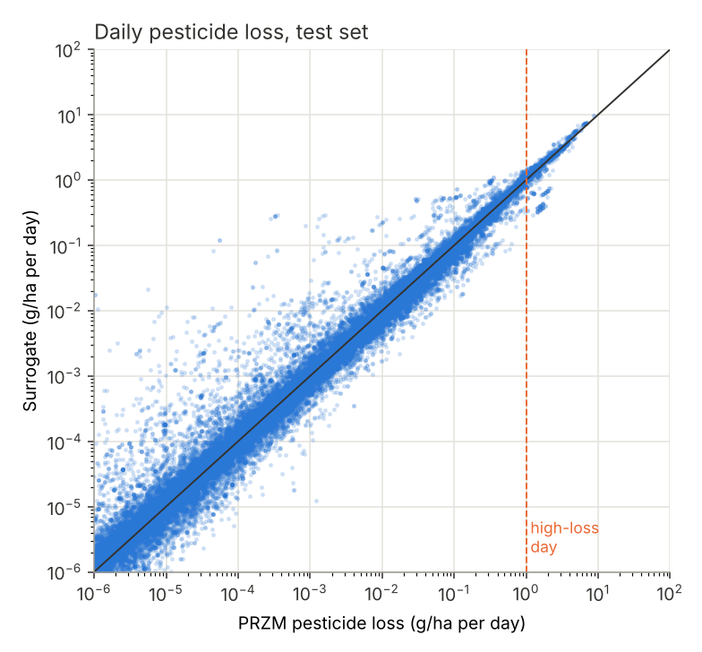

# Model report: surrogate of PRZM, high-loss days, spray-day advisor

All numbers are from the **corrected simulations** (re-run on 23 Nov 2026 with two corrected
settings, see [DATA_REPORT.md, section 6](DATA_REPORT.md#6-local-re-runs-two-settings-are-wrong-23-nov-2026)):
`python -m runoffwatch train --cv` (leave-one-year-out) and `python -m runoffwatch train` (final
models, figures), both run on 23 Nov 2026; the LSTM comparison is in
[`results/lstm_vs_trees.json`](results/lstm_vs_trees.json). Machine-readable:
[`results/cv_summary.json`](results/cv_summary.json), [`results/cv_by_year.csv`](results/cv_by_year.csv),
[`results/model_metrics.json`](results/model_metrics.json).
Which data went in: [DATA_REPORT.md](DATA_REPORT.md).

## What changed on 23 Nov 2026

The delivered simulations had two wrong settings (the Henry constant and the reference soil
moisture). All fields were re-run with corrected settings, and all models were retrained and
retested. The water results did not change; the pesticide results did.

Headline numbers, delivered data vs corrected data. The scores are from the leave-one-year-out
test (all held-out years pooled, range over the years in brackets).

| | Delivered data | Corrected data |
|---|---|---|
| Fields used | 3,958 | 5,609 |
| Rain days (final models) | 5,673,012 | 8,200,903 |
| High-loss days in the test (on how many dates) | 1,619 (86) | 6,066 (158) |
| Held-out years | 9 (1990-1998) | 10 (1990-1999) |
| Runoff, daily R² | 0.97 (0.92-0.99) | 0.98 (0.92-0.99) |
| Pesticide loss, daily R² | 0.91 (0.75-0.97) | 0.95 (0.89-0.99) |
| Sum of all loss, surrogate / PRZM | 0.92 (0.70-1.16) | 0.99 (0.86-1.12) |
| High-loss days, PR-AUC: surrogate / classifier / rain rule | 0.92 / 0.81 / 0.06 | 0.97 / 0.94 / 0.10 |
| Alarm at 1 g/ha: share of alarms that are real | 91 % | 92 % |
| Alarm at 1 g/ha: share of high-loss days found | 76 % (36-92 %) | 90 % (81-97 %) |

The old results are kept in [`results/delivered/`](results/delivered/) (and the old figures in
`figures/delivered/`), because they are the record of how the fault was found and of what the first
presentation showed.

## 1. What was built

**Surrogate of PRZM** in two stages that follow the physics:

| Stage | Input | Output | Trained on |
|---|---|---|---|
| Runoff model | today's rain, rain and temperature of the days before, evaporation, curve number, soil | mm of water running off | all 5,609 runs |
| Concentration model | days since spraying, rain and temperature since spraying, soil | g/ha of pesticide per mm of runoff | run-years that pass the quality check (in the corrected data: all of them) |

Pesticide loss = runoff x concentration. No PRZM output is used as an input.

Both are gradient-boosted trees (LightGBM). The runoff model is
**physics-informed**: the textbook curve-number runoff for today's rain is one
of its inputs, so it only has to learn how PRZM corrects that for soil moisture.

The concentration model is trained on the amount itself, with each day weighted
by its runoff, so that errors are counted in grams lost. The first version was
trained on the logarithm of the amount; it was very exact for small losses but
underestimated the large ones.

The models saved in `models/` and used by the advisor are trained on **all
years and all weather files**. Their expected accuracy is the leave-one-year-out
score below; they cannot be tested themselves because no data is left over.

**High-loss classifier**: is today a day with at least 1 g/ha pesticide loss
(0.04 % of the dose)? In the corrected data such days are 0.32 % of all rain days
(25,940 days) and carry most of the pesticide loss (DATA_REPORT.md, section 6).
It is again the weaker of the two ways to find such days (section 3), but by a smaller margin
than before, and is kept for comparison and for the driver ranking.

## 2. How it was tested, and a mistake worth knowing about

**Leave one year out.** For each application year from 1990 to 1999 in turn,
the models are trained without that year and tested on it, using only weather
files that were also kept out of training (163 of the 740). The scores below
are for all ten held-out years together, with the range over the years. (On the
delivered data there were nine: the last year, 1999, was never trusted there.)

Why so strict: the first test held out weather files only and gave
near-perfect scores. Then we checked how different the test weather really
was. For 97 % of the test weather files, a training file exists whose daily
rain is more than 90 % correlated: the files are neighbouring grid cells of
the same decade, so the "unseen" files contained the same storms on the same
days. On genuinely unseen years the picture changed (measured on the delivered
data; runoff is the same in the corrected data):

| Runoff model, daily R² | Same years, unseen files | Unseen years and files (1992, 1996) |
|---|---|---|
| First version (calendar features, large trees) | 0.97 | 0.90 |
| Curve-number formula alone (no ML) | 0.93 | 0.93 |
| Final version (formula as input, no calendar, small trees) | 0.98 | 0.98 |

The first version had memorised storms by their date and was **worse than the
plain formula** on new years. Removing the calendar features and giving the
model the formula as an input fixed it. The lesson: millions of rows, but only
ten years of regional weather behind them. The 6,066 high-loss days in the
test data fall on just 158 dates.

One caveat: the final design was chosen while looking at the years 1992, 1994
and 1996. The leave-one-year-out scores for those three years are therefore
slightly optimistic; the other seven years were not used for any design choice.

## 3. Results on years and weather files never used in training

### Water runoff

| | Daily R², all years | Range over the 10 years |
|---|---|---|
| **Surrogate** | **0.98** | 0.92 - 0.99 |
| Curve-number formula | 0.94 | 0.83 - 0.97 |

The surrogate beats the formula in every one of the ten years.

### Pesticide loss

| | Daily R², all years | Range over the 10 years |
|---|---|---|
| **Surrogate (both stages)** | **0.95** | 0.89 - 0.99 |
| Baseline: decay formula x curve-number runoff | 0.12 | -8.3 - 0.83 |

| Sum of all loss, surrogate / PRZM | All years | Range |
|---|---|---|
| | 0.99 | 0.86 - 1.12 |

Honest reading:
- The surrogate follows PRZM far better than the simple baseline in every year. The baseline is
  very unstable on the corrected data (R² below zero in two years, -8.3 in 1991).
- The year still matters, but less than before: R² 0.99 in the best year (1994), 0.89 in the
  worst (1991). A year's score is decided by a handful of storms.
- **Over all years the total loss is almost exact** (ratio 0.99). Single years are off in both
  directions: 0.86 in 1997 (14 % too low) and 1.12 in 1990 (12 % too high). On the delivered data
  the total was 8 % too low on average and 30 % too low in the worst year. A risk tool should
  still carry a safety margin for single years.

### Finding high-loss days (6,066 days on 158 dates)

| Method | PR-AUC, all years | Range over the 10 years |
|---|---|---|
| Rule: rain today | 0.10 | 0.03 - 0.27 |
| Gradient-boosting classifier | 0.94 | 0.87 - 0.98 |
| **Surrogate: predicted loss** | **0.97** | 0.93 - 0.99 |

(Logistic regression, tested on 1992 and 1996 only: 0.78, against 0.94 and 0.95 for the two models above.)

- Rain today alone is nearly useless. A high-loss day needs rain **and** fresh pesticide.
- Alarm when the surrogate predicts 1 g/ha or more: 5,937 alarms, **92 % of them real**, and
  **90 % of the high-loss days found** (between 81 % and 97 % depending on the year). So an alarm
  can be trusted, and about one high-loss day in ten is still missed.
- Predicting the amount and then applying the limit is better than predicting yes/no directly,
  but the gap is now small: the surrogate is ahead in eight of the ten years, the classifier in
  1996 and 1997. The amount model learns from every runoff day (1,042,104 in the final models);
  the yes/no model learns its positive examples from comparatively few storms.

### Speed

The corrected models need about 0.03 s for a ten-year run of one field (measured during training,
`speed` in `model_metrics.json`). PRZM needed about 3.4 s per field in the re-run on a Windows PC
(median in the re-run log). So the surrogate is roughly a hundred times faster. With the smaller
models from the delivered data the factor was a few hundred.

### A second surrogate: LSTM

`python -m runoffwatch lstm`. An LSTM is a neural network that reads the daily weather day by day
and keeps its own memory, instead of using hand-made inputs such as "rain in the previous 7 days".
Ours is small (23,906 parameters, 11 minutes of training on a laptop). Both surrogates were
trained without the years 1992, 1994 and 1996 and compared on exactly the same test rows
(test weather files, years 1992 and 1996; 402,049 rain days, 913 high-loss days).

| | Trees (main surrogate) | LSTM |
|---|---|---|
| Runoff, daily R² | **0.98** | 0.97 |
| Runoff, median error of a run's total | 6 % | **4 %** |
| Pesticide loss, daily R² | 0.96 | **0.98** |
| Pesticide loss, R² of the logarithm (small losses count as much as large ones) | **0.96** | 0.44 |
| Pesticide loss, median error of a run's total | **9 %** | 10 % |
| Sum of all loss, surrogate / PRZM | **1.03** | 0.92 |
| High-loss days, PR-AUC | 0.95 | **0.99** |
| Alarm at 1 g/ha: share of alarms that are real / share of high-loss days found | 91 % / 89 % | **97.5 %** / **90 %** |

Reading:
- **The LSTM is better** on daily pesticide loss (R² 0.98 against 0.96), on ranking high-loss days
  (PR-AUC 0.99 against 0.95), on the share of its alarms that are real (97.5 % against 91 %) and on
  the run totals of runoff.
- **The trees are better** on daily runoff (0.98 against 0.97), on small losses (R² of the logarithm
  0.96 against 0.44), and on the total: the trees are 3 % too high, the LSTM 8 % too low, which is
  the wrong direction for a risk tool. Both find about the same share of high-loss days (89 % and 90 %).
- **This is still one test on two years, not the year-by-year test.** The trees were tested by
  leaving out each of ten years; the LSTM was not. A year's score depends on a handful of storms, so
  the LSTM's lead may shrink or grow on other years.
- On the delivered data the result depended on how long the LSTM was trained; this was not checked
  again on the corrected data (it stopped after 43 rounds).
- The advisor still uses the trees: they are tested more thoroughly and need no extra software.
  Running the year-by-year test for the LSTM is the obvious next step.

### The surrogate on 45 years of real weather (France, 1979-2023)

`python -m runoffwatch france`. Every one of the 5,609 fields gets the full Agri4Cast weather
record of its own grid cell (740 grid cells), a spraying on 1 March of every year, and the
surrogate's prediction: 252,405 field-years.

A note on years: the PRZM runs label their weather 1990-1999, but it is the real weather of
2006-2015 (DATA_REPORT.md). This section uses real years.

| Period | Years | Mean predicted loss (g/ha per field and year) | High-loss days per field and year |
|---|---|---|---|
| Before the PRZM runs (1979-2005) | 27 | 1.84 | 0.42 |
| Years PRZM simulated (2006-2015) | 10 | 2.07 | 0.46 |
| After (2016-2023) | 8 | 2.80 | 0.58 |

- **Years differ far more than the average suggests.** The worst year (2022, 4.56 g/ha) has 2.8
  times the loss of the median year; the best (1997) has 0.51 g/ha. The five worst years (2022,
  2020, 2013, 1989, 2001) carry 23 % of the loss of all 45 years.
- **The yearly rain does not explain a year.** It is about the same in 2006-2015 and 2016-2023
  (709 and 708 mm on average). The risk table (section 4) suggests that what matters is heavy rain
  in the weeks after 1 March.
- **Do not read a climate trend into the table.** Eight years are few, the yearly rain is the same
  as in 2006-2015, and one or two storms in spring move a year's value a lot.

The map shows the mean predicted loss per weather grid cell. It mixes two things: the weather of
the cell and the soils of the sampled fields that lie in it.

**How far to trust this**
- For 2006-2015 the surrogate reproduces PRZM's yearly totals closely (R² 0.98 for runoff, 0.99
  for pesticide loss, sum of loss 1.00 times PRZM's, on 56,090 field-years). That is **not a
  test**: the final models were trained on these years.
- For the other 35 years there is no PRZM result to compare with. The expected accuracy is the
  leave-one-year-out score above (pesticide loss R² 0.95; total 0.99 times PRZM's over all years,
  0.86 to 1.12 in single years).
- 10 % of the field-years contain a rain day heavier than 99.9 % of the rain days in training
  (above 48 mm; the maximum is 189 mm against 158 mm in training). Those are the cases where the
  surrogate has least to go on.
- With `WINPRZM.exe` now running locally, a real test is possible: run PRZM for a few hundred
  field-years outside 2006-2015 and compare.

## 4. What drives high-loss days

On the corrected data the classifier relies most on: the rain since spraying, the days since
spraying, how much runoff today's rain would cause, the evaporation of the past week (how wet the
soil is), the rain itself, the number of heavy-rain days since spraying, and the organic carbon
of the topsoil. The ranking comes from the classifier, tested on 1992 and 1996. SHAP shows
**what the model uses**, not what causes runoff in nature; and since the model copies PRZM, it
shows PRZM's logic.

The ranking changed with the correction. On the delivered data "temperature yesterday" ranked
second and needed an explanation; it is no longer among the twelve most used inputs. The history
since spraying now comes first. Whether this ranking makes physical sense still needs an
environmental reading.

### Risk calendar

58 % of the pesticide loss happens in March and 2.2 % of March rain days are high-loss days;
April follows with 23 % of the loss (1.2 % of rain days), May with 12 %. From June on high-loss
days are very rare (at most 0.06 % of rain days). **Every run sprays on 1 March, so "March" here
means "the first weeks after spraying"**, not the month as such.

This table is the most useful single result for a farmer: in the first week
after spraying, a day with 20-30 mm of rain is a high-loss day in 92 % of the
cases; with 10-20 mm in 22 %; with less than 10 mm almost never. In weeks 5-8
the same 20-30 mm still give 52 %, and in weeks 9-16 12 %. On the delivered
data the risk faded much faster (13 % in weeks 5-8).

## 5. Spray-day advisor (prototype)

`streamlit run app.py`, or `python -m runoffwatch whatif --weather my.csv`.

Input: a daily weather table (about 30 days of history plus the forecast) and
a soil. Output: predicted pesticide loss in the 14 days after each candidate
spray day.

In the built-in made-up example a storm front arrives on 9-12 March. Spraying
on 19-23 February loses almost nothing in the following 14 days; spraying on
25 February puts the storm inside the window. (The screenshot and its numbers
are from the models trained on the delivered data.)

## 6. Limits

1. **It copies a model.** PRZM is the "truth" here. Nothing was compared with measurements.
2. **Still one pesticide, one dose, one crop, one spray date (1 March).** The advisor moves the
   spray date by days or weeks around that; it cannot say anything about spraying in May or
   October, about another product, or about another dose. That needs new PRZM runs. Even a small
   shift is an extrapolation: in the data, "days since spraying" and the calendar date always move
   together, so the models cannot separate them.
3. **The two corrections are our reading of the evidence.** The Henry constant (0.37E-06 instead
   of 0.03) and the reference soil moisture (1 instead of 100) were chosen from 30 test runs
   (DATA_REPORT.md, section 6). The model owners have not confirmed them yet. If they decide
   otherwise, the pesticide results change again.
4. **The sample is no longer a clean random sample.** 1,335 fields cannot be calculated by PRZM
   (it stops with a calculation error) and are missing. We have not found what they have in
   common, so we cannot rule out that they are a particular kind of field.
5. **Single years can be off.** Over all years the total loss is right, but in single unseen years
   it is between 14 % too low and 12 % too high, and up to a fifth of the high-loss days are missed
   (19 % in the worst year). Extreme storms unlike those in training are its weak point.
6. **Small effective sample.** Ten years of weather from one region; all high-loss days in the
   test fall on 158 dates.
7. **The advisor has not been evaluated as a decision tool.** We tested how well the surrogate
   reproduces PRZM, not whether following its advice lowers losses.
8. The app fills in evaporation from a monthly average when the weather file has none.

## 7. Next steps

- **New PRZM runs with varied spray date and dose** (and substance properties), now possible
  locally with `WINPRZM.exe`; the design is prepared in [NEW_RUNS_PLAN.md](NEW_RUNS_PLAN.md). Then
  spray date and dose become model inputs.
- Ask the model owners to confirm both corrections.
- Check the long-run predictions against PRZM itself for a sample of field-years outside 2006-2015.
- Year-by-year test for the LSTM; if its lead holds, make it the main surrogate.
- Find out why 1,335 fields cannot be calculated.
- SHAP for the surrogate itself, not only for the classifier.
