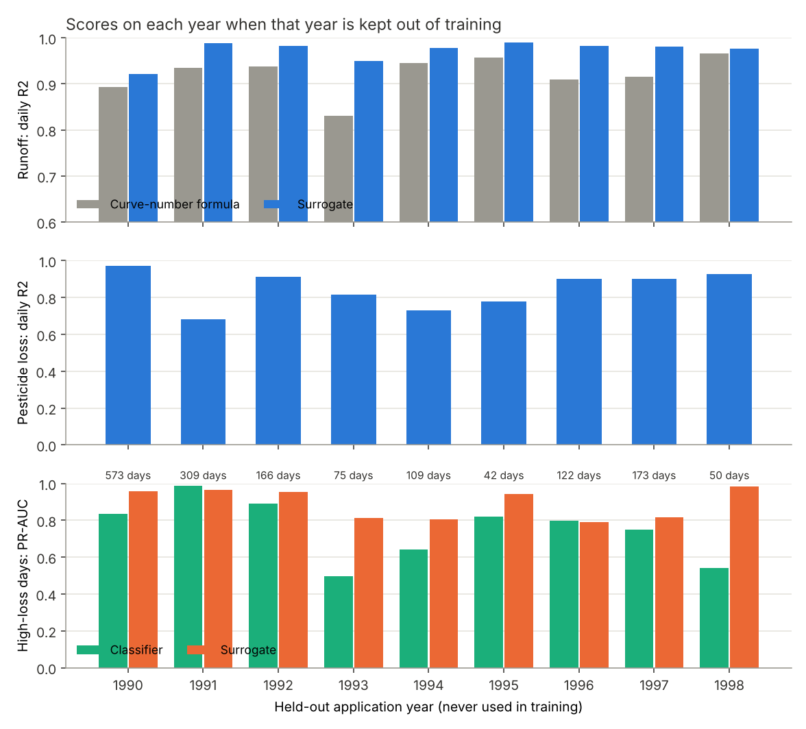

# Model report: surrogate of PRZM, high-loss days, spray-day advisor

All numbers are from `python -m runoffwatch train --cv` (leave-one-year-out) and
`python -m runoffwatch train` (final models, figures) on 12 Nov 2026. Machine-readable:
[`results/cv_summary.json`](results/cv_summary.json), [`results/cv_by_year.csv`](results/cv_by_year.csv),
[`results/model_metrics.json`](results/model_metrics.json).
Which data went in: [DATA_REPORT.md](DATA_REPORT.md).

## 1. What was built

**Surrogate of PRZM** in two stages that follow the physics:

| Stage | Input | Output | Trained on |
|---|---|---|---|
| Runoff model | today's rain, rain and temperature of the days before, evaporation, curve number, soil | mm of water running off | all 3,958 runs |
| Concentration model | days since spraying, rain and temperature since spraying, soil | g/ha of pesticide per mm of runoff | only run-years that passed the quality audit |

Pesticide loss = runoff x concentration. No PRZM output is used as an input.

Both are gradient-boosted trees (LightGBM). The runoff model is
**physics-informed**: the textbook curve-number runoff for today's rain is one
of its inputs, so it only has to learn how PRZM corrects that for soil moisture.

**High-loss classifier**: is today a day with at least 1 g/ha pesticide loss
(0.04 % of the dose)? Such days are 0.17 % of all rain days and carry 55 % of
the pesticide loss. It turned out to be the weaker of the two ways to find such
days (section 3) and is kept for comparison and for the driver ranking.

## 2. How it was tested, and a mistake worth knowing about

**Leave one year out.** For each application year from 1990 to 1998 in turn,
the models are trained without that year and tested on it, using only weather
files that were also kept out of training (153 of the 695). The scores below
are for all nine held-out years together, with the range over the years.

Why so strict: the first test held out weather files only and gave
near-perfect scores. Then we checked how different the test weather really
was. For 97 % of the test weather files, a training file exists whose daily
rain is more than 90 % correlated: the files are neighbouring grid cells of
the same decade, so the "unseen" files contained the same storms on the same
days. On genuinely unseen years the picture changed:

| Runoff model, daily R² | Same years, unseen files | Unseen years and files (1992, 1996) |
|---|---|---|
| First version (calendar features, large trees) | 0.97 | 0.90 |
| Curve-number formula alone (no ML) | 0.93 | 0.93 |
| Final version (formula as input, no calendar, small trees) | 0.98 | 0.98 |

The first version had memorised storms by their date and was **worse than the
plain formula** on new years. Removing the calendar features and giving the
model the formula as an input fixed it. The lesson: millions of rows, but only
ten years of regional weather behind them. The 1,619 high-loss days in the
test data fall on just 86 dates.

One caveat: the final design was chosen while looking at the years 1992, 1994
and 1996. The leave-one-year-out scores for those three years are therefore
slightly optimistic; the other six years were not used for any design choice.

## 3. Results on years and weather files never used in training

### Water runoff

| | Daily R², all years | Range over the 9 years |
|---|---|---|
| **Surrogate** | **0.97** | 0.92 - 0.99 |
| Curve-number formula | 0.92 | 0.83 - 0.97 |

The surrogate beats the formula in every one of the nine years.

### Pesticide loss

| | Daily R², all years | Range over the 9 years |
|---|---|---|
| **Surrogate (both stages)** | **0.87** | 0.68 - 0.97 |
| Baseline: decay formula x curve-number runoff | 0.49 | 0.24 - 0.63 |

| Sum of all loss, surrogate / PRZM | All years | Range |
|---|---|---|
| | 0.85 | 0.60 - 1.12 |

Honest reading:
- The surrogate follows PRZM far better than the simple baseline in every year.
- How well depends strongly on the year: R² 0.97 in the best, 0.68 in the worst. A year's score is
  decided by a handful of storms.
- It **underestimates the total loss by about 15 %** on average, and by 40 % in the worst year (1991).
  For a risk tool that is the wrong direction; it needs fixing or a safety margin.
- The weak years have large losses from unusual events, for example a 56 mm summer storm in August
  1994, 167 days after spraying, heavier than almost anything in the training years.

### Finding high-loss days (1,619 days on 86 dates)

| Method | PR-AUC, all years | Range over the 9 years |
|---|---|---|
| Rule: rain today | 0.06 | 0.03 - 0.27 |
| Gradient-boosting classifier | 0.81 | 0.50 - 0.99 |
| **Surrogate: predicted loss** | **0.91** | 0.79 - 0.98 |

(Logistic regression, tested on 1992 and 1996 only: 0.65, against 0.87 and 0.91 for the two models above.)

- Rain today alone is nearly useless. A high-loss day needs rain **and** fresh pesticide.
- Alarm when the surrogate predicts 1 g/ha or more: 1,272 alarms, **94 % of them real**, and
  **74 % of the high-loss days found** (between 35 % and 95 % depending on the year). So an alarm
  can be trusted, but no alarm does not mean no risk.
- Predicting the amount and then applying the limit is more reliable than predicting yes/no
  directly. The amount model learns from about 226,000 runoff days; the yes/no model has about
  4,000 positive examples from a few dozen storms.

### Speed

About 0.01 s for a 10-year run on one laptop core, against 2-4 s for PRZM
inside xLandscape (from the run logs): a few hundred times faster.

## 4. What drives high-loss days

The classifier relies most on: how much runoff today's rain would cause, the
days since spraying, the rain itself, and recent temperature and evaporation
(how wet the soil is). The ranking comes from the classifier, tested on 1992 and
1996. SHAP shows **what the model uses**, not what causes
runoff in nature; and since the model copies PRZM, it shows PRZM's logic.
"Temperature yesterday" ranking second needs an environmental explanation
(frozen or wet soil in early March?) before it goes into a report.

### Risk calendar

61 % of the pesticide loss happens in March and 1.7 % of March rain days are
high-loss days; from June on almost none. **Every run sprays on 1 March, so
"March" here means "the first weeks after spraying"**, not the month as such.

This table is the most useful single result for a farmer: in the first week
after spraying, a day with 20-30 mm of rain is a high-loss day in 93 % of the
cases; with 10-20 mm in 22 %; with less than 10 mm almost never. Eight weeks
later the same 20-30 mm give 13 %.

## 5. Spray-day advisor (prototype)

`streamlit run app.py`, or `python -m runoffwatch whatif --weather my.csv`.

Input: a daily weather table (about 30 days of history plus the forecast) and
a soil. Output: predicted pesticide loss in the 14 days after each candidate
spray day.

In the built-in made-up example a storm front arrives on 9-12 March. Spraying
on 19-23 February loses almost nothing in the following 14 days; spraying on
25 February puts the storm inside the window and loses 5.8 g/ha.

## 6. Limits

1. **It copies a model.** PRZM is the "truth" here. Nothing was compared with measurements.
2. **One pesticide, one dose, one crop, one spray date (1 March).** The advisor moves the spray
   date by days or weeks around that; it cannot say anything about spraying in May or October,
   about another product, or about another dose. That needs new PRZM runs. Even a small shift is
   an extrapolation: in the data, "days since spraying" and the calendar date always move together,
   so the models cannot separate them.
3. **Underestimates totals by about 15 %** on unseen years, and misses a quarter of the high-loss
   days (two thirds in the worst year). Extreme storms unlike those in training are its weak point.
4. **Small effective sample.** Ten years of weather from one region; all high-loss days fall on 86 dates.
   The models in `models/` are trained without the years 1992, 1994 and 1996.
5. **Part of the training targets may be slightly contaminated** by the simulator problem
   described in DATA_REPORT.md, below what the quality rule can detect.
6. **The advisor has not been evaluated as a decision tool.** We tested how well the surrogate
   reproduces PRZM, not whether following its advice lowers losses.
7. The app fills in evaporation from a monthly average when the weather file has none.

## 7. Next steps

- Train the final models on all years (the year-by-year evaluation now gives the honest score).
- Fix the underestimation of large events (for example train the amount directly, or calibrate on the validation year).
- Compare with a sequence model (LSTM); related work uses them for this kind of surrogate.
- Ask Landau for runs with varied spray date, dose and pesticide, and for a rerun without the numerical problem.
