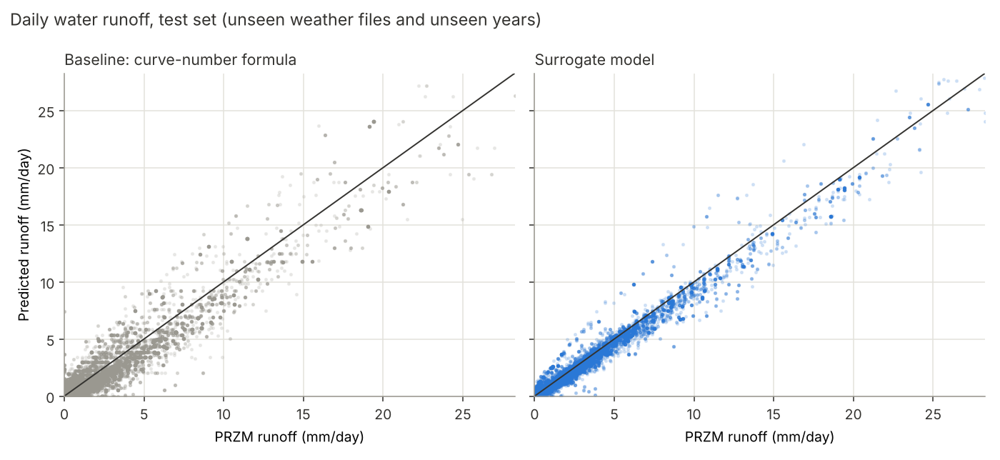
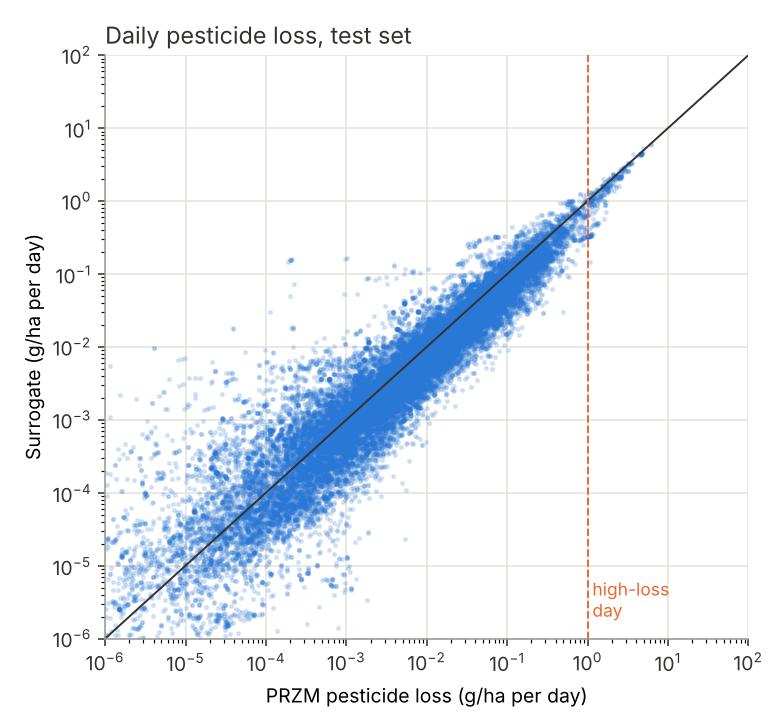
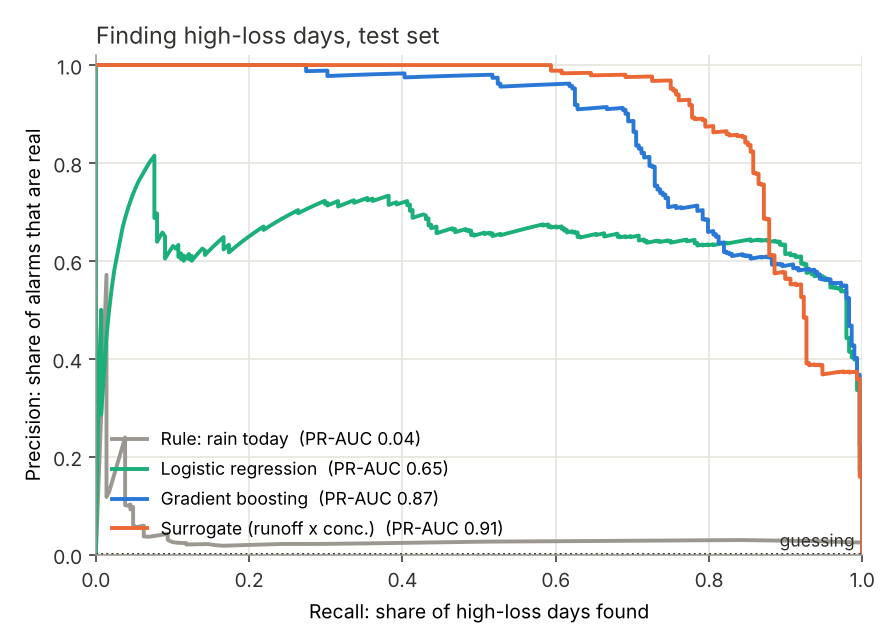
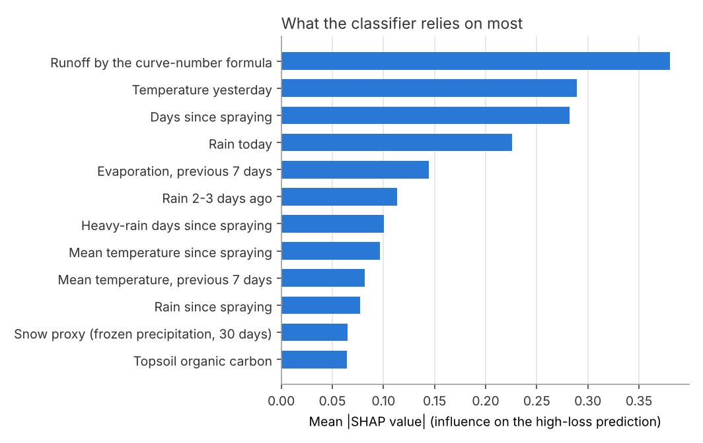
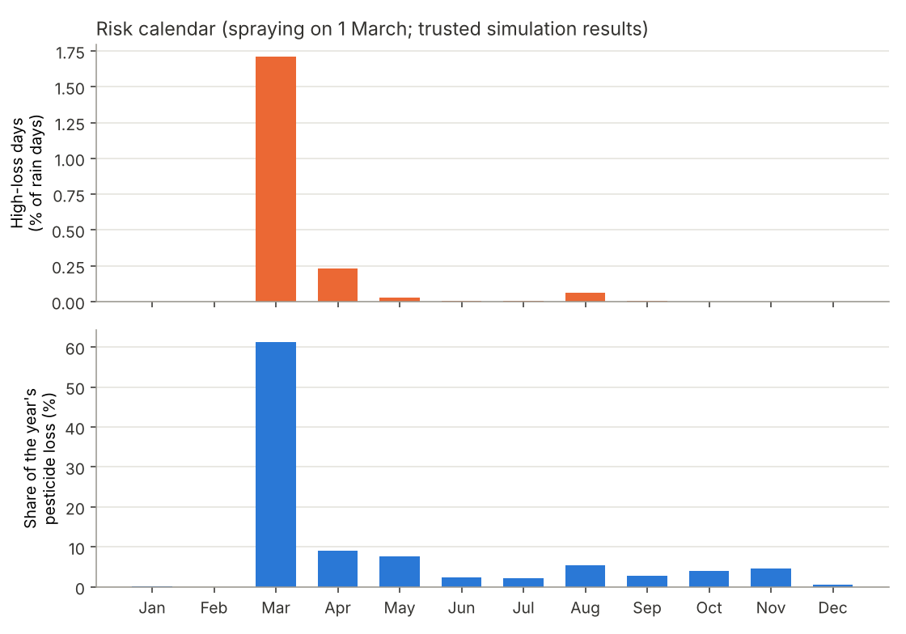
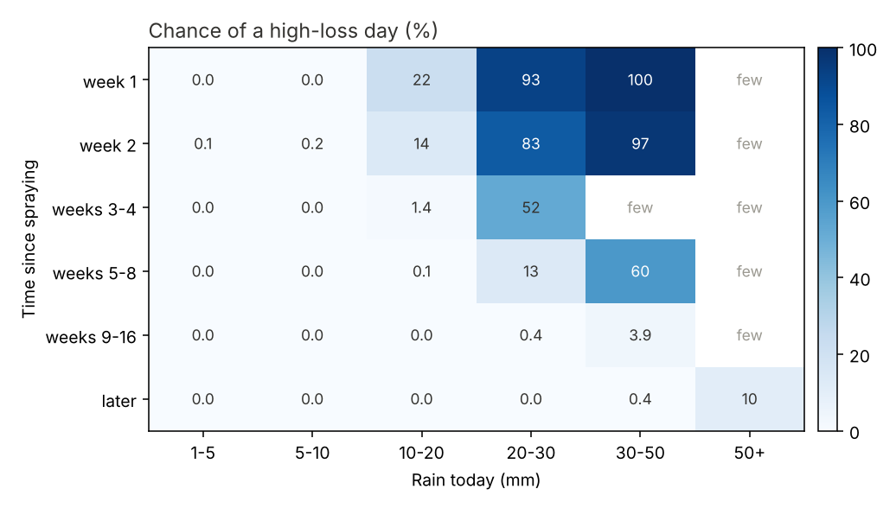
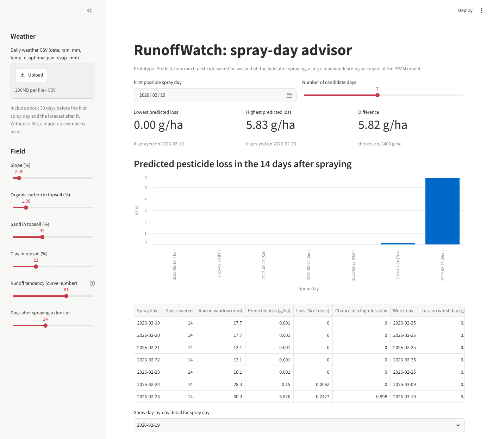

# Model report: surrogate of PRZM, high-loss days, spray-day advisor

All numbers are from `python -m runoffwatch train` on 12 Nov 2026.
Machine-readable version: [`results/model_metrics.json`](results/model_metrics.json).
Which data went in: [DATA_REPORT.md](DATA_REPORT.md).

## 1. What was built

**Surrogate of PRZM** in two stages that follow the physics:

| Stage | Input | Output | Trained on |
|---|---|---|---|
| Runoff model | today's rain, rain and temperature of the days before, evaporation, curve number, soil | mm of water running off | all 3,958 runs |
| Concentration model | days since spraying, rain and temperature since spraying, soil | g/ha of pesticide per mm of runoff | only run-years that passed the quality audit |

Pesticide loss = runoff x concentration. No PRZM output is used as an input.

Both are gradient-boosted trees (LightGBM). The runoff model is
**physics-informed**: the textbook curve-number runoff for today's rain is one
of its inputs, so it only has to learn how PRZM corrects that for soil moisture.

**High-loss classifier**: is today a day with at least 1 g/ha pesticide loss
(0.04 % of the dose)? Such days are 0.17 % of all rain days and carry 55 % of
the pesticide loss.

## 2. How it was tested, and a mistake worth knowing about

The test set contains **weather files and years that training never saw**:
153 of the 695 weather files, application years 1992 and 1996. The year 1994
is used to decide when to stop training.

Why both: the first test held out weather files only. It gave near-perfect
scores. Then we checked how different the test weather really was: for 97 % of
the test weather files, a training file exists whose daily rain is more than
90 % correlated. The weather files are neighbouring grid cells of the same
decade, so the "unseen" files contained the same storms on the same days.

Holding out whole years as well changed the picture:

| Runoff model, daily R² | Same years, unseen files | Unseen years and files |
|---|---|---|
| First version (calendar features, large trees) | 0.97 | 0.90 |
| Curve-number formula alone (no ML) | 0.93 | 0.93 |
| Final version (formula as input, no calendar, small trees) | 0.98 | **0.98** |

The first version had memorised storms by their date and was **worse than the
plain formula** on new years. Removing the calendar features and giving the
model the formula as an input fixed it. The lesson for the report: millions of
rows, but only ten years of regional weather behind them.

## 3. Results on unseen weather files and unseen years

### Water runoff

| | Daily R² | RMSE (mm) | Median error of a run's total |
|---|---|---|---|
| **Surrogate** | **0.981** | 0.16 | **6 %** |
| Curve-number formula | 0.927 | 0.31 | 25 % |

### Pesticide loss

| | Daily R² | R² of log loss on runoff days | Median error of a run's total | Sum of all loss, predicted / PRZM |
|---|---|---|---|---|
| **Surrogate (both stages)** | **0.941** | 0.855 | 22 % | 0.83 |
| Concentration stage with PRZM's own runoff | 0.960 | 0.955 | 18 % | 0.86 |
| Baseline: decay formula x curve-number runoff | 0.307 | below 0 | 62 % | 0.55 |

Honest reading:
- The surrogate follows PRZM closely day by day, far better than the simple baseline.
- It **underestimates the total loss by about 17 %** on new years, and by about 10 % on the
  largest days. For a risk tool that is the wrong direction; it needs fixing or a safety margin.
- Per held-out year: daily R² 0.93 (1992) and 0.95 (1996). Two years are a small sample.

### Finding high-loss days (288 such days in the test set)

| Method | PR-AUC | Precision at 80 % recall |
|---|---|---|
| Rule: rain today | 0.04 | 3 % |
| Logistic regression | 0.65 | 64 % |
| Gradient-boosting classifier | 0.87 | 66 % |
| **Surrogate: predicted loss ≥ 1 g/ha** | **0.91** | **88 %** |

- Rain today alone is nearly useless. A high-loss day needs rain **and** fresh pesticide.
- Using the surrogate's predicted amount with the 1 g/ha limit: 230 alarms, 95 % of them
  real, 76 % of the high-loss days found.
- Predicting the amount and then applying the limit works at least as well as predicting
  yes/no directly. The amount model learns from 226,000 runoff days; the yes/no model has
  only 4,000 positive examples.
- By year the ranking is not stable: PR-AUC 0.97 vs 0.89 in 1992 (surrogate vs classifier),
  0.85 vs 0.90 in 1996.

### Speed

About 0.01 s for a 10-year run on one laptop core, against 2-4 s for PRZM
inside xLandscape (from the run logs): a few hundred times faster.

## 4. What drives high-loss days

The classifier relies most on: how much runoff today's rain would cause, the
days since spraying, the rain itself, and recent temperature and evaporation
(how wet the soil is). SHAP shows **what the model uses**, not what causes
runoff in nature; and since the model copies PRZM, it shows PRZM's logic.
"Temperature yesterday" ranking second needs an environmental explanation
(frozen or wet soil in early March?) before it goes into a report.

### Risk calendar

61 % of the pesticide loss happens in March and 1.7 % of March rain days are
high-loss days; from June on almost none. **Every run sprays on 1 March, so
"March" here means "the first weeks after spraying"**, not the month as such.

This table is the most useful single result for a farmer: in the first week
after spraying, a day with 20-30 mm of rain is a high-loss day in 93 % of the
cases; with 10-20 mm in 22 %; with less than 10 mm almost never. Eight weeks
later the same 20-30 mm give 13 %.

## 5. Spray-day advisor (prototype)

`streamlit run app.py`, or `python -m runoffwatch whatif --weather my.csv`.

Input: a daily weather table (about 30 days of history plus the forecast) and
a soil. Output: predicted pesticide loss in the 14 days after each candidate
spray day.

In the built-in made-up example a storm front arrives on 9-12 March. Spraying
on 19-23 February loses almost nothing in the following 14 days; spraying on
25 February puts the storm inside the window and loses 5.8 g/ha.

## 6. Limits

1. **It copies a model.** PRZM is the "truth" here. Nothing was compared with measurements.
2. **One pesticide, one dose, one crop, one spray date (1 March).** The advisor moves the spray
   date by days or weeks around that; it cannot say anything about spraying in May or October,
   about another product, or about another dose. That needs new PRZM runs.
3. **Underestimates totals by about 17 %** on unseen years.
4. **Small effective sample.** Ten years of weather from one region; two held-out years.
5. **Part of the training targets may be slightly contaminated** by the simulator problem
   described in DATA_REPORT.md, below what the quality rule can detect.
6. **The advisor has not been evaluated as a decision tool.** We tested how well the surrogate
   reproduces PRZM, not whether following its advice lowers losses.
7. The app fills in evaporation from a monthly average when the weather file has none.

## 7. Next steps

- Repeat the evaluation with other held-out years to get error bars.
- Fix the underestimation of large events (for example train the amount directly, or calibrate on the validation year).
- Compare with a sequence model (LSTM); related work uses them for this kind of surrogate.
- Ask Landau for runs with varied spray date, dose and pesticide, and for a rerun without the numerical problem.
