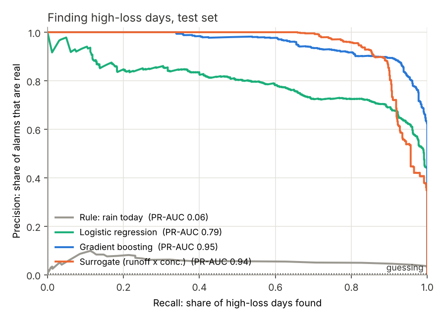
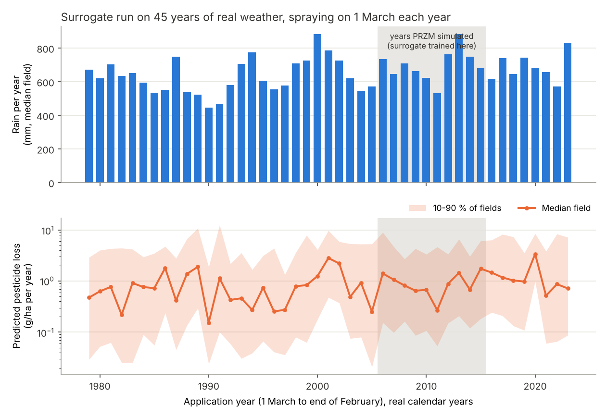
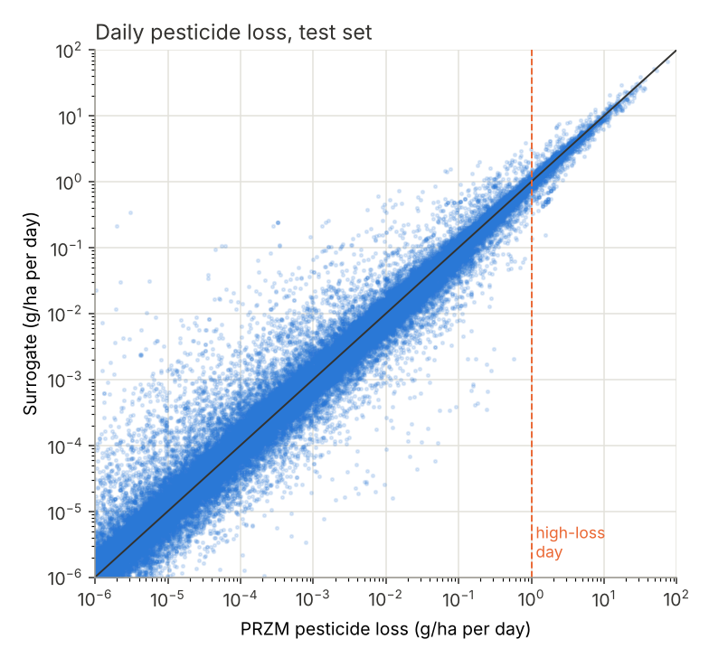
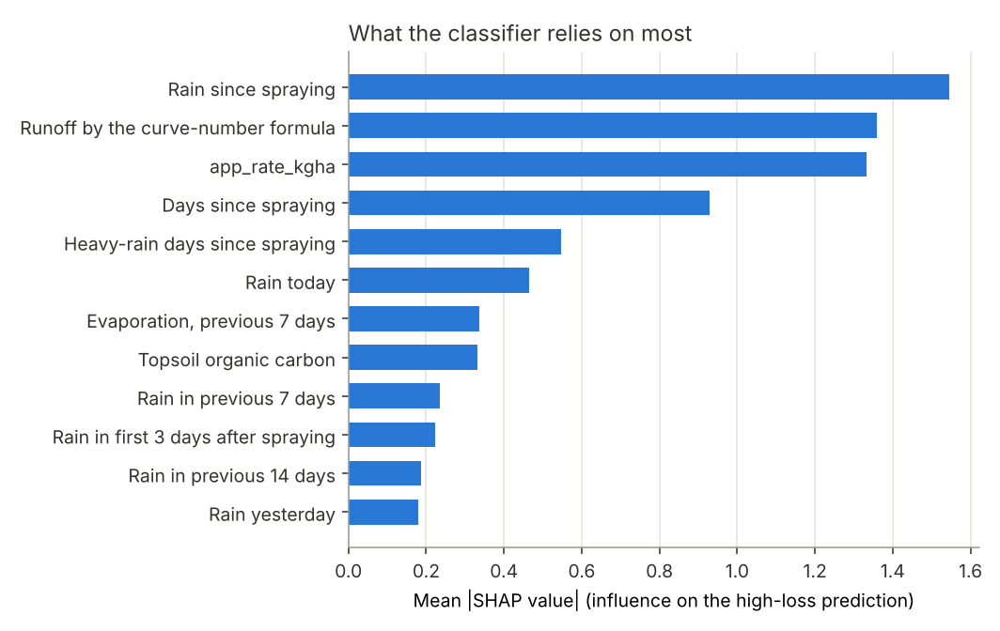
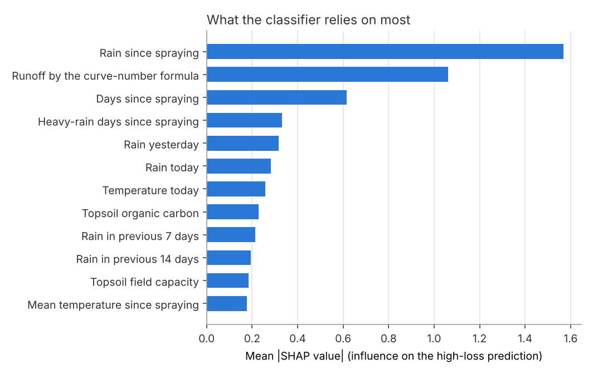
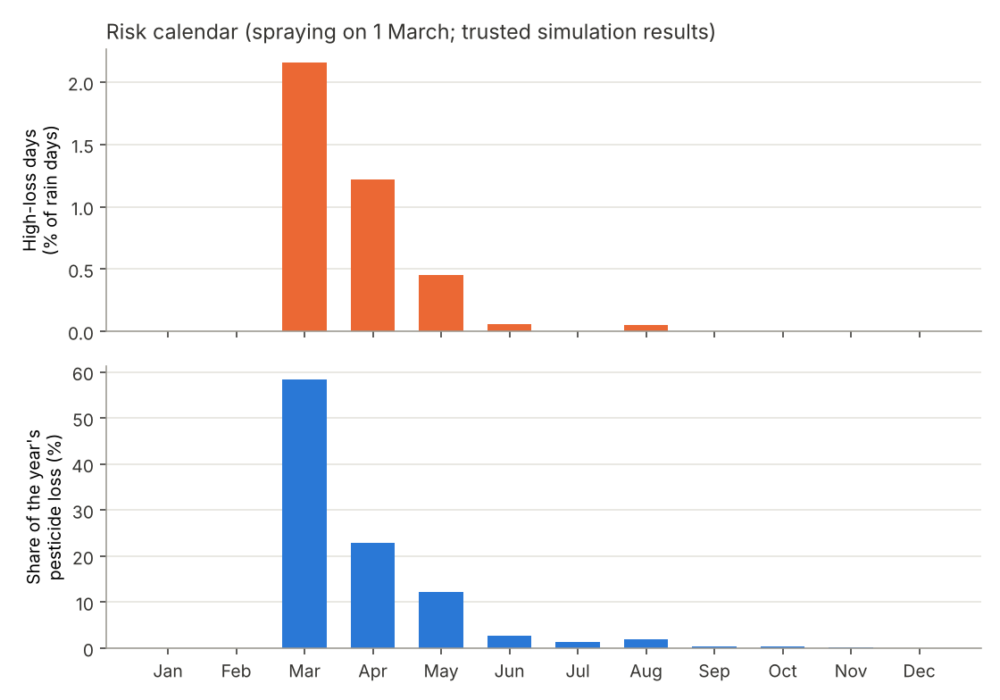
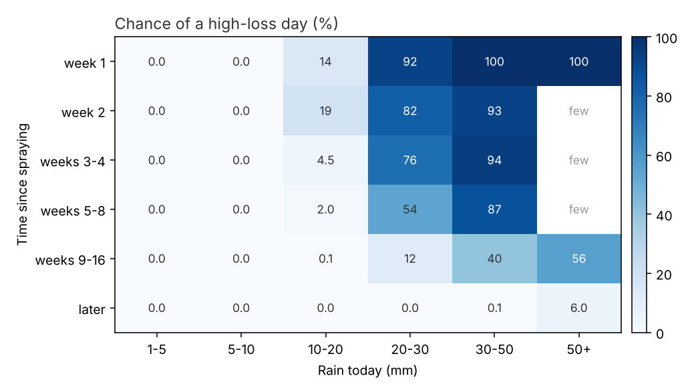

# Model report: surrogate of PRZM, high-loss days, spray-day advisor

Two data sets are reported here. **Section 4** is the newest: models trained on simulations with
**varied spray dates and doses** (25 Nov 2026). **Sections 1 to 3 and 5** describe the
corrected simulations that are all sprayed on 1 March with 2.4 kg/ha; sections 6 to 8 cover both. Those results are still valid and are
the comparison for section 4.

The 1-March numbers are from the **corrected simulations** (re-run on 23 Nov 2026 with two corrected
settings, see [DATA_REPORT.md, section 6](DATA_REPORT.md#6-local-re-runs-two-settings-are-wrong-23-nov-2026)):
`python -m runoffwatch train --cv` (leave-one-year-out) and `python -m runoffwatch train` (final
models, figures), both run on 23 Nov 2026; the LSTM comparison is in
[`results/lstm_vs_trees.json`](results/lstm_vs_trees.json). Machine-readable:
[`results/cv_summary.json`](results/cv_summary.json), [`results/cv_by_year.csv`](results/cv_by_year.csv),
[`results/model_metrics.json`](results/model_metrics.json).
Which data went in: [DATA_REPORT.md](DATA_REPORT.md).

## What changed on 25 Nov 2026

Until now every simulation was sprayed on 1 March with 2.4 kg/ha. So the models could not say
anything about another spray day or another dose. Now each field got two more PRZM runs: one
sprayed in spring (15 Feb - 30 Apr) and one in autumn (1 Oct - 30 Nov), on a different random day
in each year, with a dose of 0.24, 1.20 or 2.40 kg/ha. The tree models were retrained and retested on
this larger data set (the LSTM was not adapted). Results: [section 4](#4-results-with-varied-spray-dates-and-doses).

In short:
- The task got harder, and the scores stayed about the same. Only the daily pesticide loss got a
  little worse (R² 0.95 -> 0.92).
- In one year (1990) a simple formula beats the surrogate. We do not know why yet.
- **PRZM loses 2 to 7 times more of the dose when spraying is in autumn than in spring.** The
  reason is the fixed crop calendar of the PRZM scenario, not the chemistry
  ([section 4](#what-przm-says-about-the-spray-date-and-why)).
- The spray-day advisor now uses these new models (`models/varied`) when they are there.

## What changed on 23 Nov 2026

The delivered simulations had two wrong settings (the Henry constant and the reference soil
moisture). All fields were re-run with corrected settings, and all models were retrained and
retested. The water results did not change; the pesticide results did.

Headline numbers, delivered data vs corrected data. The scores are from the leave-one-year-out
test (all held-out years pooled, range over the years in brackets).

| | Delivered data | Corrected data |
|---|---|---|
| Fields used | 3,958 | 5,609 |
| Rain days (final models) | 5,673,012 | 8,200,903 |
| High-loss days in the test (on how many dates) | 1,619 (86) | 6,066 (158) |
| Held-out years | 9 (1990-1998) | 10 (1990-1999) |
| Runoff, daily R² | 0.97 (0.92-0.99) | 0.98 (0.92-0.99) |
| Pesticide loss, daily R² | 0.91 (0.75-0.97) | 0.95 (0.89-0.99) |
| Sum of all loss, surrogate / PRZM | 0.92 (0.70-1.16) | 0.99 (0.86-1.12) |
| High-loss days, PR-AUC: surrogate / classifier / rain rule | 0.92 / 0.81 / 0.06 | 0.97 / 0.94 / 0.10 |
| Alarm at 1 g/ha: share of alarms that are real | 91 % | 92 % |
| Alarm at 1 g/ha: share of high-loss days found | 76 % (36-92 %) | 90 % (81-97 %) |

The old results are kept in [`results/delivered/`](results/delivered/) (and the old figures in
`figures/delivered/`), because they are the record of how the fault was found and of what the first
presentation showed.

## 1. What was built

**Surrogate of PRZM** in two stages that follow the physics:

| Stage | Input | Output | Trained on |
|---|---|---|---|
| Runoff model | today's rain, rain and temperature of the days before, evaporation, curve number, soil | mm of water running off | all 5,609 runs |
| Concentration model | days since spraying, rain and temperature since spraying, soil | g/ha of pesticide per mm of runoff | run-years that pass the quality check (in the corrected data: all of them) |

Pesticide loss = runoff x concentration. No PRZM output is used as an input.

Both are gradient-boosted trees (LightGBM). The runoff model is
**physics-informed**: the textbook curve-number runoff for today's rain is one
of its inputs, so it only has to learn how PRZM corrects that for soil moisture.

The concentration model is trained on the amount itself, with each day weighted
by its runoff, so that errors are counted in grams lost. The first version was
trained on the logarithm of the amount; it was very exact for small losses but
underestimated the large ones.

The models saved in `models/` (1 March only) and in `models/varied/` (varied spray dates and
doses, section 4) are trained on **all years and all weather files**. Their expected accuracy is
the leave-one-year-out score; they cannot be tested themselves because no data is left over. The
advisor uses `models/varied/` when that folder is there.

**High-loss classifier**: is today a day with at least 1 g/ha pesticide loss
(0.04 % of the dose)? In the corrected data such days are 0.32 % of all rain days
(25,940 days) and carry most of the pesticide loss (DATA_REPORT.md, section 6).
On the 1-March data it is again the weaker of the two ways to find such days (section 3), but by
a smaller margin than before, and is kept for comparison and for the driver ranking. With varied
spray dates and doses it is as good as the surrogate (section 4).

## 2. How it was tested, and a mistake worth knowing about

**Leave one year out.** For each application year from 1990 to 1999 in turn,
the models are trained without that year and tested on it, using only weather
files that were also kept out of training (163 of the 740). The scores below
are for all ten held-out years together, with the range over the years. (On the
delivered data there were nine: the last year, 1999, was never trusted there.)

Why so strict: the first test held out weather files only and gave
near-perfect scores. Then we checked how different the test weather really
was. For 97 % of the test weather files, a training file exists whose daily
rain is more than 90 % correlated: the files are neighbouring grid cells of
the same decade, so the "unseen" files contained the same storms on the same
days. On genuinely unseen years the picture changed (measured on the delivered
data; runoff is the same in the corrected data):

| Runoff model, daily R² | Same years, unseen files | Unseen years and files (1992, 1996) |
|---|---|---|
| First version (calendar features, large trees) | 0.97 | 0.90 |
| Curve-number formula alone (no ML) | 0.93 | 0.93 |
| Final version (formula as input, no calendar, small trees) | 0.98 | 0.98 |

The first version had memorised storms by their date and was **worse than the
plain formula** on new years. Removing the calendar features and giving the
model the formula as an input fixed it. The lesson: millions of rows, but only
ten years of regional weather behind them. The 6,066 high-loss days in the
test data fall on just 158 dates.

One caveat: the final design was chosen while looking at the years 1992, 1994
and 1996. The leave-one-year-out scores for those three years are therefore
slightly optimistic; the other seven years were not used for any design choice.

## 3. Results on years and weather files never used in training (sprayed on 1 March)

### Water runoff

| | Daily R², all years | Range over the 10 years |
|---|---|---|
| **Surrogate** | **0.98** | 0.92 - 0.99 |
| Curve-number formula | 0.94 | 0.83 - 0.97 |

The surrogate beats the formula in every one of the ten years.

### Pesticide loss

| | Daily R², all years | Range over the 10 years |
|---|---|---|
| **Surrogate (both stages)** | **0.95** | 0.89 - 0.99 |
| Baseline: decay formula x curve-number runoff | 0.12 | -8.3 - 0.83 |

| Sum of all loss, surrogate / PRZM | All years | Range |
|---|---|---|
| | 0.99 | 0.86 - 1.12 |

Honest reading:
- The surrogate follows PRZM far better than the simple baseline in every year. The baseline is
  very unstable on the corrected data (R² below zero in two years, -8.3 in 1991).
- The year still matters, but less than before: R² 0.99 in the best year (1994), 0.89 in the
  worst (1991). A year's score is decided by a handful of storms.
- **Over all years the total loss is almost exact** (ratio 0.99). Single years are off in both
  directions: 0.86 in 1997 (14 % too low) and 1.12 in 1990 (12 % too high). On the delivered data
  the total was 8 % too low on average and 30 % too low in the worst year. A risk tool should
  still carry a safety margin for single years.

### Finding high-loss days (6,066 days on 158 dates)

| Method | PR-AUC, all years | Range over the 10 years |
|---|---|---|
| Rule: rain today | 0.10 | 0.03 - 0.27 |
| Gradient-boosting classifier | 0.94 | 0.87 - 0.98 |
| **Surrogate: predicted loss** | **0.97** | 0.93 - 0.99 |

(Logistic regression, tested on 1992 and 1996 only: 0.78, against 0.94 and 0.95 for the two models above.)

- Rain today alone is nearly useless. A high-loss day needs rain **and** fresh pesticide.
- Alarm when the surrogate predicts 1 g/ha or more: 5,937 alarms, **92 % of them real**, and
  **90 % of the high-loss days found** (between 81 % and 97 % depending on the year). So an alarm
  can be trusted, and about one high-loss day in ten is still missed.
- Predicting the amount and then applying the limit is better than predicting yes/no directly,
  but the gap is now small: the surrogate is ahead in eight of the ten years, the classifier in
  1996 and 1997. The amount model learns from every runoff day (1,042,104 in the final models);
  the yes/no model learns its positive examples from comparatively few storms.

### Speed

The corrected models need about 0.03 s for a ten-year run of one field (measured during training,
`speed` in `model_metrics.json`). PRZM needed about 3.4 s per field in the re-run on a Windows PC
(median in the re-run log). So the surrogate is roughly a hundred times faster. With the smaller
models from the delivered data the factor was a few hundred.

### A second surrogate: LSTM

`python -m runoffwatch lstm`. An LSTM is a neural network that reads the daily weather day by day
and keeps its own memory, instead of using hand-made inputs such as "rain in the previous 7 days".
Ours is small (23,906 parameters, 11 minutes of training on a laptop). Both surrogates were
trained without the years 1992, 1994 and 1996 and compared on exactly the same test rows
(test weather files, years 1992 and 1996; 402,049 rain days, 913 high-loss days).

| | Trees (main surrogate) | LSTM |
|---|---|---|
| Runoff, daily R² | **0.98** | 0.97 |
| Runoff, median error of a run's total | 6 % | **4 %** |
| Pesticide loss, daily R² | 0.96 | **0.98** |
| Pesticide loss, R² of the logarithm (small losses count as much as large ones) | **0.96** | 0.44 |
| Pesticide loss, median error of a run's total | **9 %** | 10 % |
| Sum of all loss, surrogate / PRZM | **1.03** | 0.92 |
| High-loss days, PR-AUC | 0.95 | **0.99** |
| Alarm at 1 g/ha: share of alarms that are real / share of high-loss days found | 91 % / 89 % | **97.5 %** / **90 %** |

Reading:
- **The LSTM is better** on daily pesticide loss (R² 0.98 against 0.96), on ranking high-loss days
  (PR-AUC 0.99 against 0.95), on the share of its alarms that are real (97.5 % against 91 %) and on
  the run totals of runoff.
- **The trees are better** on daily runoff (0.98 against 0.97), on small losses (R² of the logarithm
  0.96 against 0.44), and on the total: the trees are 3 % too high, the LSTM 8 % too low, which is
  the wrong direction for a risk tool. Both find about the same share of high-loss days (89 % and 90 %).
- **This is still one test on two years, not the year-by-year test.** The trees were tested by
  leaving out each of ten years; the LSTM was not. A year's score depends on a handful of storms, so
  the LSTM's lead may shrink or grow on other years.
- On the delivered data the result depended on how long the LSTM was trained; this was not checked
  again on the corrected data (it stopped after 43 rounds).
- The advisor still uses the trees: they are tested more thoroughly and need no extra software.
  Running the year-by-year test for the LSTM is the obvious next step.

### The surrogate on 45 years of real weather (France, 1979-2023)

`python -m runoffwatch france`. Every one of the 5,609 fields gets the full Agri4Cast weather
record of its own grid cell (740 grid cells), a spraying on 1 March of every year, and the
surrogate's prediction: 252,405 field-years.

A note on years: the PRZM runs label their weather 1990-1999, but it is the real weather of
2006-2015 (DATA_REPORT.md). This section uses real years.

| Period | Years | Mean predicted loss (g/ha per field and year) | High-loss days per field and year |
|---|---|---|---|
| Before the PRZM runs (1979-2005) | 27 | 1.84 | 0.42 |
| Years PRZM simulated (2006-2015) | 10 | 2.07 | 0.46 |
| After (2016-2023) | 8 | 2.80 | 0.58 |

**With the new models** (`models/varied`, section 4; still 1 March and 2.4 kg/ha for every field,
5,609 fields, 740 grid cells) the mean loss is 1.84, 2.07 and 2.91 g/ha for the three periods, so
almost the same. The worst five years are the same: 2022 (4.7), 2020 (4.5), 2013 (4.2), 1989
(4.0), 2001 (3.9). In 2006-2015 they agree with PRZM with yearly loss R² 0.99 and a sum ratio of
1.00 (again not a test). The long run was only made for spraying on 1 March; an autumn version has
not been run. Result files: [`results/varied/france_summary.json`](results/varied/france_summary.json),
[`results/varied/france_by_year.csv`](results/varied/france_by_year.csv).

- **Years differ far more than the average suggests.** The worst year (2022, 4.56 g/ha) has 2.8
  times the loss of the median year; the best (1997) has 0.51 g/ha. The five worst years (2022,
  2020, 2013, 1989, 2001) carry 23 % of the loss of all 45 years.
- **The yearly rain does not explain a year.** It is about the same in 2006-2015 and 2016-2023
  (709 and 708 mm on average). The risk table (section 5) suggests that what matters is heavy rain
  in the weeks after 1 March.
- **Do not read a climate trend into the table.** Eight years are few, the yearly rain is the same
  as in 2006-2015, and one or two storms in spring move a year's value a lot.

The map shows the mean predicted loss per weather grid cell. It mixes two things: the weather of
the cell and the soils of the sampled fields that lie in it.

**How far to trust this**
- For 2006-2015 the surrogate reproduces PRZM's yearly totals closely (R² 0.98 for runoff, 0.99
  for pesticide loss, sum of loss 1.00 times PRZM's, on 56,090 field-years). That is **not a
  test**: the final models were trained on these years.
- For the other 35 years there is no PRZM result to compare with. The expected accuracy is the
  leave-one-year-out score above (pesticide loss R² 0.95; total 0.99 times PRZM's over all years,
  0.86 to 1.12 in single years).
- 10 % of the field-years contain a rain day heavier than 99.9 % of the rain days in training
  (above 48 mm; the maximum is 189 mm against 158 mm in training). Those are the cases where the
  surrogate has least to go on.
- With `WINPRZM.exe` now running locally, a real test is possible: run PRZM for a few hundred
  field-years outside 2006-2015 and compare.

## 4. Results with varied spray dates and doses

Added 25 Nov 2026. Commands: `python -m runoffwatch --dataset varied train` and
`python -m runoffwatch --dataset varied train --cv` (see the README, "Analysing the runs with
varied spray dates and doses"). Models: `models/varied/`. Result files:
[`results/varied/cv_summary.json`](results/varied/cv_summary.json),
[`results/varied/cv_by_year.csv`](results/varied/cv_by_year.csv),
[`results/varied/model_metrics.json`](results/varied/model_metrics.json),
[`results/varied/loss_by_spray_date.csv`](results/varied/loss_by_spray_date.csv),
[`results/varied/loss_after_spraying.csv`](results/varied/loss_after_spraying.csv),
[`results/varied/quality_summary.json`](results/varied/quality_summary.json).
All figures of this data set are in `figures/varied/`.

### The data set

- Each of the 5,609 fields with a full corrected result got two more PRZM runs, with the same
  corrected settings: one sprayed in spring (15 Feb - 30 Apr) and one in autumn (1 Oct - 30 Nov).
  Each run has a different random spray day in each of its ten years. The dose of each run is
  0.24, 1.20 or 2.40 kg/ha.
- 11,218 runs were made; 11,209 are usable. All 11,209 pass PRZM's own yearly balance check.
  Nine result files are empty and left out (DATA_REPORT.md, section 6).
- The models learn from the 5,609 runs sprayed on 1 March plus the 11,209 new runs: 16,818 runs,
  24,589,483 rain days, 92,768 high-loss days (at least 1 g/ha).
- The models get two new inputs: the day of the year of the last spraying and its dose.

### Year-by-year test

Same test as in section 3: each of the ten years is held out once, and the weather files of the
test fields are never used in training. The first two columns are the earlier results.

| Score | Delivered data | Corrected, 1 March only | **Varied dates and doses** |
|---|---|---|---|
| Rain days scored | - | 1,831,844 | 5,355,895 |
| High-loss days / storm dates | - | 6,066 / 158 | 21,222 / 622 |
| Runoff, daily R² (range over years) | 0.97 | 0.98 (0.92-0.99) | 0.98 (0.92-0.99) |
| Runoff, daily R² of the curve-number formula | - | 0.94 | 0.94 |
| Pesticide loss, daily R² (range) | 0.91 (0.75-0.97) | 0.95 (0.89-0.99) | 0.92 (0.78-0.97) |
| Sum of all loss, surrogate / PRZM (range) | 0.92 (0.70-1.16) | 0.99 (0.86-1.12) | 0.98 (0.90-1.18) |
| High-loss days, PR-AUC: surrogate / classifier / rain rule | 0.92 / 0.81 / 0.06 | 0.97 / 0.94 / 0.10 | 0.97 / 0.97 / 0.11 |
| Alarm at 1 g/ha: number of alarms | - | 5,937 | 21,263 |
| Alarm at 1 g/ha: share of alarms that are real | 91 % | 92 % | 92 % |
| Alarm at 1 g/ha: share of high-loss days found (range) | 76 % (36-92 %) | 90 % (81-97 %) | 92 % (88-96 %) |

Honest reading:
- **The task got harder and the scores stayed about the same.** The model must now handle any
  spray day in two windows and three doses. Only the daily pesticide loss R² dropped, from 0.95 to
  0.92.
- **1990 is the weak year.** There the loss R² is 0.78 and the total is 18 % too high. The simple
  baseline (decay formula x curve-number runoff, now fitted per kg applied) scores 0.85 in 1990, so
  **the baseline beats the surrogate in that one year**. 1990 is also the weakest year for runoff
  (0.92). In the other nine years the surrogate beats the baseline (all years together: 0.92
  against 0.79). The next weakest years are 1998 (0.88) and 1993 (0.89). We have not yet
  investigated why.
- The classifier is now as good as the surrogate at ranking high-loss days (PR-AUC 0.972 against
  0.968). With 1 March only it was behind (0.94 against 0.97).

### Scores by spray window and by dose

| Group | High-loss days | Loss R² | Sum of loss, surrogate / PRZM | Alarms real | High-loss days found |
|---|---|---|---|---|---|
| Spring (15 Feb - 30 Apr) | 9,395 | 0.97 | 0.99 | 92 % | 91 % |
| Autumn (1 Oct - 30 Nov) | 11,827 | 0.90 | 0.98 | 91 % | 92 % |
| Dose 0.24 kg/ha | 1,025 | 0.92 | 0.99 | 89 % | 88 % |
| Dose 1.2 kg/ha | 5,798 | 0.93 | 0.99 | 91 % | 92 % |
| Dose 2.4 kg/ha | 14,399 | 0.92 | 0.98 | 92 % | 92 % |

(Year-by-year test. The 1 March runs count as spring and as 2.4 kg/ha.)

- Autumn is harder than spring (loss R² 0.90 against 0.97).
- The small dose is scored on only 1,025 high-loss days, so its numbers are less certain.

### One fixed split (test years 1992 and 1996)

This is the split used for the figures and for SHAP. The test fields' weather files were never
used in training. Numbers from [`results/varied/model_metrics.json`](results/varied/model_metrics.json).

- Runoff R² 0.982 (curve-number formula 0.928).
- Pesticide loss R² 0.963; R² of the logarithm on runoff days 0.964; sum of loss 0.965 times
  PRZM's; on the top 0.1 % of days 0.94 times PRZM's.
- The chemistry stage alone (given PRZM's true runoff): R² 0.989, sum ratio 1.00. So much of the
  error comes from the runoff stage, not from the chemistry.
- High-loss days, PR-AUC: surrogate 0.970, gradient-boosting classifier 0.972, logistic regression
  0.766, rain rule 0.081.
- Alarm at 1 g/ha: 3,759 alarms, 94 % of them real, 90 % of the high-loss days found. 74 % of the
  pesticide loss falls on alarm days.

### What drives high-loss days now (SHAP)

SHAP measures how much each input moves the classifier's answer (mean absolute value; higher =
used more). The ranking: rain since spraying 1.55, curve-number runoff of today's rain 1.36, dose
1.33, days since spraying 0.93, heavy-rain days since spraying 0.55, rain today 0.46, evaporation
of the past 7 days 0.34, organic carbon of the topsoil 0.33. The dose is now among the top three;
on the 1-March data it could not appear because it never changed. As before, SHAP shows what the
model uses, which is PRZM's logic, not nature's.

### Speed and cost

- The final models are trained on all 24.6 million rows (trees: runoff 237, concentration 1,486,
  classifier 1,647).
- The surrogate needs 0.05 s per ten-year run, PRZM about 3.4 s: about 70 times faster.
- Training needs about 12 GB of memory and 22 minutes; the year-by-year test 70 minutes. Run each
  in its own command.

### What PRZM says about the spray date, and why

This part is **not a model result**. It is read directly from the PRZM simulations.

**How much of the dose is lost, by spray date.** A "season" here is the time from one spraying to
the next spraying in the same run; only seasons of at least 300 days are counted.

| Sprayed | Seasons | Mean % of dose lost | Median | 90th percentile |
|---|---|---|---|---|
| Feb 1-15 | 725 | 0.08 | 0.03 | 0.20 |
| Feb 16-end | 9,838 | 0.09 | 0.03 | 0.21 |
| Mar 1-15 | 66,449 | 0.08 | 0.03 | 0.19 |
| Mar 16-end | 10,627 | 0.07 | 0.03 | 0.19 |
| Apr 1-15 | 9,936 | 0.08 | 0.04 | 0.21 |
| Apr 16-end | 9,236 | 0.10 | 0.04 | 0.27 |
| Oct 1-15 | 12,360 | 0.47 | 0.32 | 1.07 |
| Oct 16-end | 13,273 | 0.60 | 0.36 | 1.42 |
| Nov 1-15 | 12,386 | 0.39 | 0.15 | 1.02 |
| Nov 16-end | 12,252 | 0.19 | 0.09 | 0.41 |

(The row "Feb 1-15" exists only because of a leap-year shift; ignore it. "Mar 1-15" contains the
runs sprayed on 1 March.) File: [`results/varied/loss_by_spray_date.csv`](results/varied/loss_by_spray_date.csv).

**Autumn spraying loses 2 to 7 times more of the dose than spring spraying.**

**Why.** We looked at the first 30 days after each spraying (mean per season). The curve number is
the number PRZM uses for how easily rain becomes runoff: the higher, the more runoff.
File: [`results/varied/loss_after_spraying.csv`](results/varied/loss_after_spraying.csv).

| Sprayed | Seasons | Rain, mm | Runoff, mm | Mean curve number | % of dose lost | % of dose lost per mm of runoff |
|---|---|---|---|---|---|---|
| Feb 16-end | 9,838 | 51 | 0.9 | 80.5 | 0.05 | 0.056 |
| Mar 1-15 | 66,449 | 52 | 0.8 | 80.5 | 0.05 | 0.057 |
| Mar 16-end | 10,627 | 49 | 0.7 | 80.5 | 0.04 | 0.050 |
| Apr 1-15 | 9,936 | 55 | 1.1 | 80.5 | 0.05 | 0.046 |
| Apr 16-end | 9,236 | 66 | 1.5 | 80.5 | 0.07 | 0.047 |
| Oct 1-15 | 12,360 | 74 | 7.8 | 87.0 | 0.37 | 0.047 |
| Oct 16-end | 13,273 | 78 | 9.4 | 86.0 | 0.55 | 0.058 |
| Nov 1-15 | 12,386 | 75 | 5.3 | 82.2 | 0.33 | 0.063 |
| Nov 16-end | 12,252 | 75 | 2.9 | 80.5 | 0.15 | 0.051 |

The table uses half-months, so the first half of November mixes days before and after emergence.
Splitting November at the emergence date (a one-off check on the varied runs alone): sprayed
1 to 11 Nov, 5.9 mm of runoff and 0.38 % of the dose lost in the first 30 days; sprayed 12 to
15 Nov, 3.0 mm and 0.17 %. The rain was about the same (75 and 70 mm).

Reading:
- **The chemistry is the same.** One millimetre of runoff carries about the same share of the
  dose in every window (0.05 to 0.06 %).
- **The amount of runoff in the first month is what differs.** It is 0.7 to 1.5 mm in spring,
  8 to 9 mm in October and 2.9 mm in late November. The rain differs far less (49 to 66 mm in
  spring, 74 to 78 mm in autumn).
- **The cause is PRZM's crop calendar.** Every field is winter cereals with the same calendar in
  every year: emergence 12 Nov, maturity 10 Jun, harvest 31 Jul. Between harvest and emergence
  the field counts as stubble or bare soil, with a high curve number, so far more rain runs off.
  From 12 Nov, in every field and every year, the curve number drops by 5 to 10 points. With the
  same rain, runoff then falls by more than half.
- After day 120 the loss is negligible in every window (under 0.005 % of the dose).

**What this means.**
- The finding is: in PRZM, **spraying before the crop has emerged loses about 5 times more than
  spraying after**.
- **The sharp step in mid-November is a property of the PRZM scenario, not of nature.** It is
  the fixed emergence date of 12 Nov. In reality emergence differs by field and by year, so the change
  is spread out over different dates.
- An autumn herbicide in winter cereals is usually sprayed around sowing or emergence (general
  knowledge, still to be confirmed by the environmental-science side). That is the high-loss
  window. The 1 March date of the delivered data is the low-loss window.
- **For the spray-day advisor:** the surrogate copies PRZM, so it copies PRZM's crop calendar too.
  It can compare spray days with each other. But advice like "wait until after 12 November" is
  only as true as the fixed emergence date of the scenario.

## 5. What drives high-loss days (sprayed on 1 March)

On the corrected data the classifier relies most on: the rain since spraying, the days since
spraying, how much runoff today's rain would cause, the evaporation of the past week (how wet the
soil is), the rain itself, the number of heavy-rain days since spraying, and the organic carbon
of the topsoil. The ranking comes from the classifier, tested on 1992 and 1996. SHAP shows
**what the model uses**, not what causes runoff in nature; and since the model copies PRZM, it
shows PRZM's logic.

The ranking changed with the correction. On the delivered data "temperature yesterday" ranked
second and needed an explanation; it is no longer among the twelve most used inputs. The history
since spraying now comes first. Whether this ranking makes physical sense still needs an
environmental reading.

### Risk calendar

58 % of the pesticide loss happens in March and 2.2 % of March rain days are high-loss days;
April follows with 23 % of the loss (1.2 % of rain days), May with 12 %. From June on high-loss
days are very rare (at most 0.06 % of rain days). **Every run sprays on 1 March, so "March" here
means "the first weeks after spraying"**, not the month as such.

This table is the most useful single result for a farmer: in the first week
after spraying, a day with 20-30 mm of rain is a high-loss day in 92 % of the
cases; with 10-20 mm in 22 %; with less than 10 mm almost never. In weeks 5-8
the same 20-30 mm still give 52 %, and in weeks 9-16 12 %. On the delivered
data the risk faded much faster (13 % in weeks 5-8).

## 6. Spray-day advisor (prototype)

`streamlit run app.py`, or `python -m runoffwatch whatif --weather my.csv`.

Input: a daily weather table (about 30 days of history plus the forecast) and
a soil. Output: predicted pesticide loss in the 14 days after each candidate
spray day.

**Which models it uses (25 Nov 2026).** The app uses the models in `models/varied/` when that
folder is there (on the command line: `python -m runoffwatch --dataset varied whatif`). These models have seen other spray days and doses: spray days from 15 Feb to
30 Apr and from 1 Oct to 30 Nov, and doses of 0.24, 1.2 and 2.4 kg/ha (section 4). Inside those
windows and doses it can compare spray days and doses. Outside them (for example spraying in June)
it is a guess. Without `models/varied/` it falls back to the models in `models/`, which only know
spraying on 1 March with 2.4 kg/ha.

Keep in mind: the surrogate copies PRZM's fixed crop calendar (emergence 12 Nov). It can say which
of two days is better in PRZM, but a step around 12 November is a property of the scenario, not
of a real field ([section 4](#what-przm-says-about-the-spray-date-and-why)).

In the built-in made-up example a storm front arrives on 9-12 March. Spraying
on 19-23 February loses almost nothing in the following 14 days; spraying on
25 February puts the storm inside the window. (The screenshot and its numbers
are from the models trained on the delivered data.)

## 7. Limits

1. **It copies a model.** PRZM is the "truth" here. Nothing was compared with measurements.
2. **One pesticide, one crop, a fixed crop calendar, and limited spray days and doses.** The
   models in `models/varied/` have seen spray days from 15 Feb to 30 Apr and from 1 Oct to 30 Nov,
   and doses from 0.24 to 2.4 kg/ha. Spraying from May to September, other doses, other products
   and other crops are not covered. Every field has the same crop calendar in every year
   (emergence 12 Nov, harvest 31 Jul), so part of the spray-date effect is the effect of this
   calendar (section 4). The older models in `models/` know only spraying on 1 March with
   2.4 kg/ha; with them, "days since spraying" and the calendar date always move together.
3. **The two corrections are our reading of the evidence.** The Henry constant (0.37E-06 instead
   of 0.03) and the reference soil moisture (1 instead of 100) were chosen from 30 test runs
   (DATA_REPORT.md, section 6). The model owner in Landau has not confirmed them yet, nor the
   intended dose (2.4 kg/ha looks about ten times usual field rates). If they decide otherwise,
   the pesticide results change again.
4. **The sample is no longer a clean random sample.** 1,335 fields cannot be calculated by PRZM
   (it stops with a calculation error) and are missing. All of them have a zero in their input
   file (a soil water or density value, the erodibility, or the slope; DATA_REPORT.md, section 6),
   which looks like missing soil or terrain data. If such gaps are more common in some regions or
   soil types, those are under-represented here.
5. **Single years can be off.** Over all years the total loss is right, but in single unseen years
   it is between 14 % too low and 12 % too high (1 March data), and up to a fifth of the high-loss
   days are missed (19 % in the worst year). With varied spray dates the total is between 0.90 and
   1.18 times PRZM's in single years. Extreme storms unlike those in training are its weak point.
6. **1990 is not understood.** With varied spray dates the surrogate is worse than the simple
   baseline in 1990 (loss R² 0.78 against 0.85). We have not investigated why.
7. **Small effective sample.** Ten years of weather from one region; all high-loss days in the
   test fall on 158 dates (622 dates with varied spray dates).
8. **The LSTM only knows 1 March.** It is not adapted to varied spray dates and refuses such runs.
   Its numbers in section 3 are from the 1-March data.
9. **The long run on 45 years of French weather is for 1 March only.** An autumn version has not
   been made.
10. **The advisor has not been evaluated as a decision tool.** We tested how well the surrogate
   reproduces PRZM, not whether following its advice lowers losses.
11. The limit of 1 g/ha for a "high-loss day" is our own choice.
12. The app fills in evaporation from a monthly average when the weather file has none.

## 8. Next steps

- Done on 25 Nov 2026: PRZM runs with varied spray date and dose, and models that use them
  (section 4). Still open from [NEW_RUNS_PLAN.md](NEW_RUNS_PLAN.md): varying substance properties
  (half-life, sorption).
- Find out why 1990 (and, less so, 1998 and 1993) is weak with varied spray dates, and why the
  baseline wins in 1990.
- Ask the environmental-science side when an autumn herbicide is really sprayed, and whether
  runs with emergence dates that differ by field and year are possible.
- Run the 45-year French weather for an autumn spray date (`france --spray DD.MM`).
- Adapt the LSTM to varied spray dates; year-by-year test for the LSTM; if its lead holds, make it
  the main surrogate.
- Ask the model owner in Landau to confirm both corrections and the intended dose.
- Check the long-run predictions against PRZM itself for a sample of field-years outside 2006-2015.
- Ask where the zeros in the input of the 1,335 failing fields come from, and whether they can be filled.
- SHAP for the surrogate itself, not only for the classifier.
