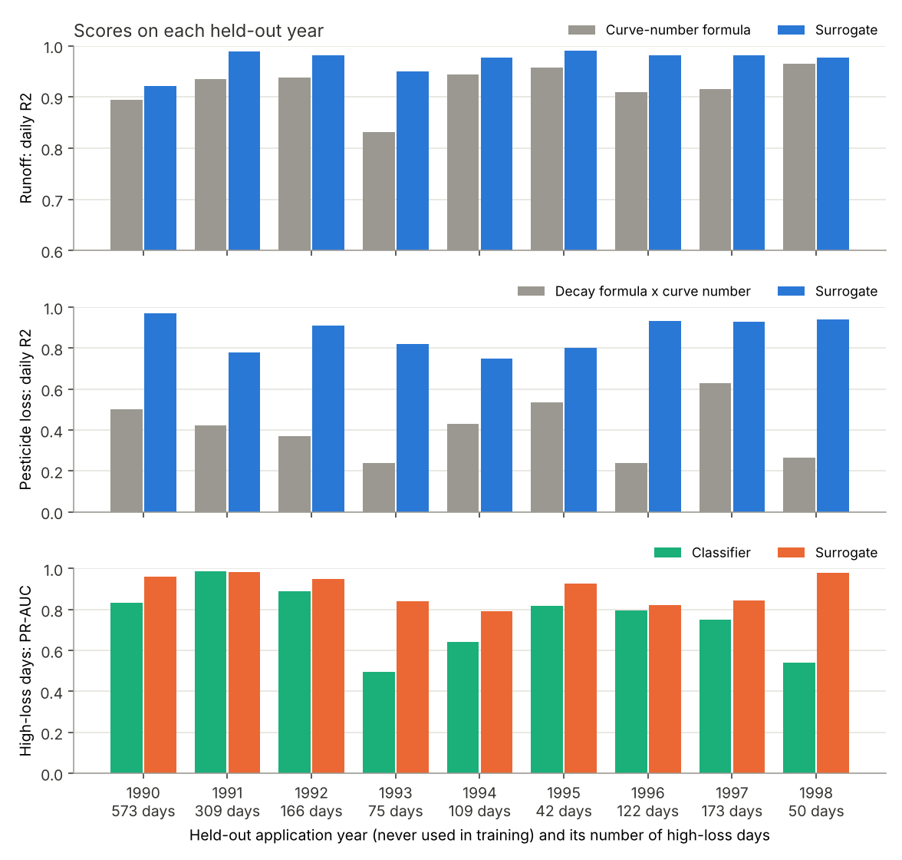
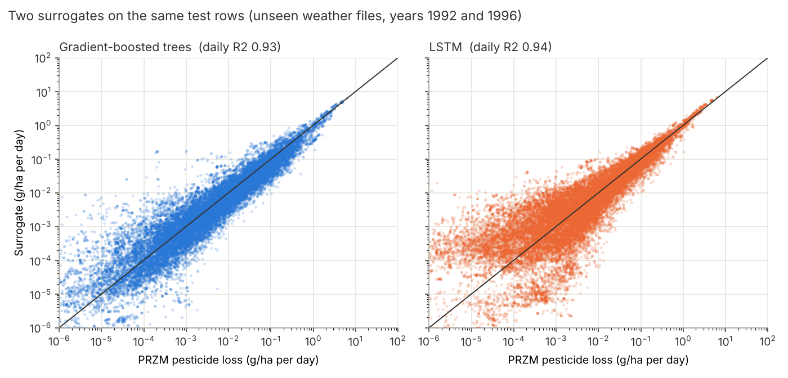
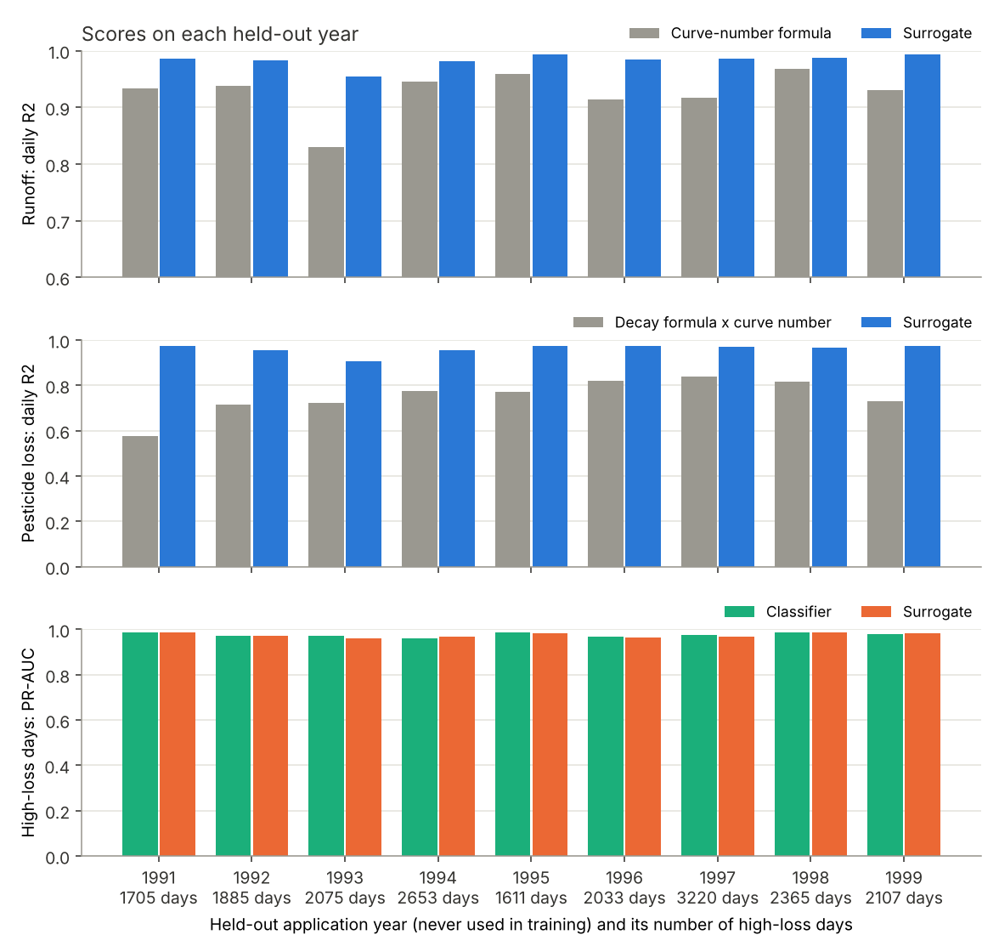
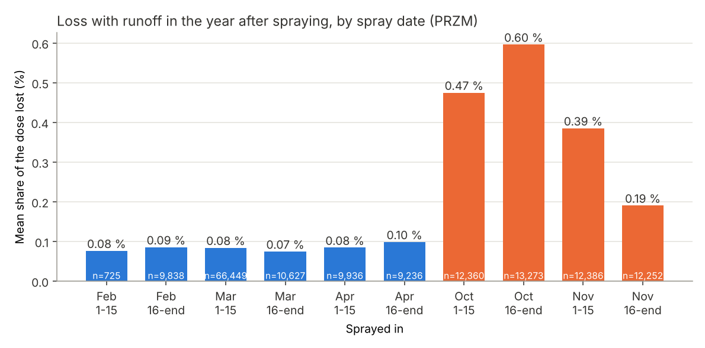
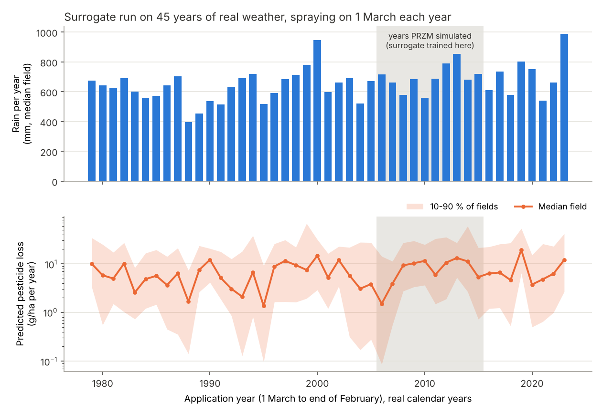

# Model report: surrogate of PRZM, high-loss days, spray-day advisor

Two data sets are reported here. **Section 4** is the newest: models trained on simulations with
**varied spray dates and doses** (25 Nov 2026). **Sections 1 to 3 and 5** describe the
corrected simulations that are all sprayed on 1 March with 2.4 kg/ha; sections 6 to 8 cover both. Those results are still valid and are
the comparison for section 4.

All scores in this report were recomputed on 25 Nov 2026 (evening) with the **warm-up rule**
(see the next block). The 1-March numbers are from the **corrected simulations** (re-run on 23 Nov 2026 with two corrected
settings, see [DATA_REPORT.md, section 6](DATA_REPORT.md#6-local-re-runs-two-settings-are-wrong-23-nov-2026)):
`python -m runoffwatch train --cv` (leave-one-year-out) and `python -m runoffwatch train` (final
models, figures), first run on 23 Nov 2026 and run again on 25 Nov 2026 with the warm-up rule. The
LSTM comparison in [`results/lstm_vs_trees.json`](results/lstm_vs_trees.json) is older (23 Nov
2026, before the warm-up rule). Machine-readable:
[`results/cv_summary.json`](results/cv_summary.json), [`results/cv_by_year.csv`](results/cv_by_year.csv),
[`results/model_metrics.json`](results/model_metrics.json).
Which data went in: [DATA_REPORT.md](DATA_REPORT.md).

## What changed on 26 Nov 2026: high-loss limit as a share of the dose

A fixed limit of 1 g/ha for a "high-loss day" cannot hold across compounds, so the app now counts a
day as a high-loss day when the field loses at least a chosen share of the dose (start value 0.1 %,
adjustable). The alarm was scored again for several shares, from the saved held-out predictions; no
model was retrained. Results:
[section 4, high-loss limit as a share of the dose](#high-loss-limit-as-a-share-of-the-dose-26-nov-2026).
Why 1991 is the weakest year of the 1-March models: section 3, pesticide loss. Scores marked
"at 1 g/ha" below use the old fixed limit.

## What changed on 25 Nov 2026 (evening): warm-up rule

**The rule.** In every run the first crop cycle starts before the simulation: emergence is
12 Nov 1989, the simulation starts on 1 Jan 1990. Until the first emergence inside the simulation
(12 Nov 1990) PRZM carries an irregular crop. Canopy interception and runoff differ from all later
years. So now:
- rain days before 12 Nov 1990 are left out;
- pesticide results of sprayings made before that date are not trusted.

This applies to all 5,609 corrected 1-March runs and all 11,209 varied runs. Application year 1990
drops out of the year-by-year test, so **nine held-out years remain (1991-1999)**.

**Why.** 1990 was the weakest year, and the simple baseline beat the surrogate there. Most of its
error sat on two storm days in November 1990, in fields sprayed that autumn. PRZM's own yearly
balance shows why: the share of the dose that lands on the crop canopy is very different in the
first year (sample of 1,200 varied runs):

| Sprayed | Year 1 | Years 2-10 |
|---|---|---|
| Autumn, before 12 Nov | 90 % (every run) | 0 % |
| Autumn, from 12 Nov | 5 % | 4 % |
| Spring (15 Feb - 30 Apr) | 35 % | 57 % |

For the 1 March runs it is 26 % in year 1 and 47 % in years 2-10. On the canopy the pesticide
behaves differently, and the surrogate has no canopy input. Runoff in Aug-Oct 1990 was also lower
than in the regular years. So 1990 was not a fair test, and its rows also disturbed training.
Details: PROJECT_HANDOFF.md, sections 5.2 and 6.9.

**Before and after** (year-by-year test, all held-out years pooled, range over the years in
brackets; before = ten years 1990-1999, after = nine years 1991-1999):

| | Varied, before | **Varied, after** | 1 March, before | **1 March, after** |
|---|---|---|---|---|
| Runoff, daily R² | 0.980 (0.92-0.99) | **0.986 (0.954-0.993)** | 0.98 (0.92-0.99) | **0.986 (0.954-0.993)** |
| Pesticide loss, daily R² | 0.917 (0.78-0.97) | **0.965 (0.907-0.976)** | 0.95 (0.89-0.99) | **0.948 (0.867-0.986)** |
| Sum of all loss, surrogate / PRZM | 0.98 (0.90-1.18) | **0.985 (0.950-1.082)** | 0.99 (0.86-1.12) | **0.948 (0.831-1.086)** |
| High-loss days, PR-AUC: surrogate / classifier | 0.968 / 0.972 | **0.973 / 0.975** | 0.97 / 0.94 | **0.965 / 0.954** |
| Alarm at the fixed limit of 1 g/ha: share of alarms that are real | 91.7 % | **92.6 %** | 92 % | **91.7 %** |
| Alarm at the fixed limit of 1 g/ha: share of high-loss days found | 91.8 % (87.7-96.0 %) | **92.6 % (89.3-95.6 %)** | 90 % (81-97 %) | **88.0 % (80.1-97.7 %)** |

In short:
- With varied spray dates the daily loss got clearly better (R² 0.917 -> 0.965). Autumn gained most.
- 1998 also improved (loss R² 0.883 -> 0.966). Part of its old weakness came from the warm-up rows.
- With 1 March only the daily scores stayed about the same, but the total over all years is now
  5 % too low (0.948), not 1 % (0.99).
- All numbers below are the new ones, unless marked "(before the warm-up rule)".

## What changed on 25 Nov 2026

(This block is the record of the morning of 25 Nov 2026. Its numbers are from before the warm-up
rule; see the block above for the new ones.)

Until now every simulation was sprayed on 1 March with 2.4 kg/ha. So the models could not say
anything about another spray day or another dose. Now each field got two more PRZM runs: one
sprayed in spring (15 Feb - 30 Apr) and one in autumn (1 Oct - 30 Nov), on a different random day
in each year, with a dose of 0.24, 1.20 or 2.40 kg/ha. The tree models were retrained and retested on
this larger data set (the LSTM was not adapted). Results: [section 4](#4-results-with-varied-spray-dates-and-doses).

In short:
- The task got harder, and the scores stayed about the same. Only the daily pesticide loss got a
  little worse (R² 0.95 -> 0.92).
- In one year (1990) a simple formula beat the surrogate. The reason was found later: 1990 is a
  warm-up year (block above).
- **PRZM loses 2 to 8 times more of the dose when spraying is in autumn than in spring.** The
  reason is the fixed crop calendar of the PRZM scenario, not the chemistry
  ([section 4](#what-przm-says-about-the-spray-date-and-why)).
- The spray-day advisor now uses these new models (`models/varied`) when they are there.

## What changed on 23 Nov 2026

The delivered simulations had two wrong settings (the Henry constant and the reference soil
moisture). All fields were re-run with corrected settings, and all models were retrained and
retested. The water results did not change; the pesticide results did.

Headline numbers, delivered data vs corrected data. The scores are from the leave-one-year-out
test (all held-out years pooled, range over the years in brackets). All numbers in this table are
from before the warm-up rule.

| | Delivered data | Corrected data |
|---|---|---|
| Fields used | 3,958 | 5,609 |
| Rain days (final models) | 5,673,012 | 8,200,903 |
| High-loss days in the test (on how many dates) | 1,619 (86) | 6,066 (158) |
| Held-out years | 9 (1990-1998) | 10 (1990-1999) |
| Runoff, daily R² | 0.97 (0.92-0.99) | 0.98 (0.92-0.99) |
| Pesticide loss, daily R² | 0.91 (0.75-0.97) | 0.95 (0.89-0.99) |
| Sum of all loss, surrogate / PRZM | 0.92 (0.70-1.16) | 0.99 (0.86-1.12) |
| High-loss days, PR-AUC: surrogate / classifier / rain rule | 0.92 / 0.81 / 0.06 | 0.97 / 0.94 / 0.10 |
| Alarm at 1 g/ha: share of alarms that are real | 91 % | 92 % |
| Alarm at 1 g/ha: share of high-loss days found | 76 % (36-92 %) | 90 % (81-97 %) |

The old results are kept in [`results/delivered/`](results/delivered/) (and the old figures in
`figures/delivered/`), because they are the record of how the fault was found and of what the first
presentation showed.

## 1. What was built

**Surrogate of PRZM** in two stages that follow the physics:

| Stage | Input | Output | Trained on |
|---|---|---|---|
| Runoff model | today's rain, rain and temperature of the days before, evaporation, curve number, soil | mm of water running off | all 5,609 runs (warm-up left out) |
| Concentration model | days since spraying, rain and temperature since spraying, soil | g/ha of pesticide per mm of runoff | run-years that pass the quality check (in the corrected data: all of them, warm-up left out) |

Pesticide loss = runoff x concentration. No PRZM output is used as an input.

Both are gradient-boosted trees (LightGBM). The runoff model is
**physics-informed**: the textbook curve-number runoff for today's rain is one
of its inputs, so it only has to learn how PRZM corrects that for soil moisture.

The concentration model is trained on the amount itself, with each day weighted
by its runoff, so that errors are counted in grams lost. The first version was
trained on the logarithm of the amount; it was very exact for small losses but
underestimated the large ones.

The models saved in `models/` (1 March only) and in `models/varied/` (varied spray dates and
doses, section 4) are trained on **all years and all weather files** (warm-up left out). Their expected accuracy is
the leave-one-year-out score; they cannot be tested themselves because no data is left over. The
advisor uses `models/varied/` when that folder is there.

**High-loss classifier**: is today a day with at least 1 g/ha pesticide loss
(0.04 % of the dose)? It still uses this fixed limit of 1 g/ha; the app's alarm does not use the
classifier but the predicted loss amount (section 4, share of the dose). In the corrected data such days are 0.32 % of all rain days
(25,940 days, before the warm-up rule) and carry most of the pesticide loss (DATA_REPORT.md, section 6).
On the 1-March data it is again the weaker of the two ways to find such days (section 3), but by
a smaller margin than before, and is kept for comparison and for the driver ranking. With varied
spray dates and doses it is as good as the surrogate (section 4).

## 2. How it was tested, and a mistake worth knowing about

**Leave one year out.** For each application year from 1991 to 1999 in turn,
the models are trained without that year and tested on it, using only weather
files that were also kept out of training (163 of the 740). The scores below
are for all nine held-out years together, with the range over the years.
Application year 1990 is no longer tested: it is the warm-up year, and too few trusted rows are
left in it (see the warm-up block at the top). (On the delivered data there were nine years,
1990-1998: the last year, 1999, was never trusted there.)

Why so strict: the first test held out weather files only and gave
near-perfect scores. Then we checked how different the test weather really
was. For 97 % of the test weather files, a training file exists whose daily
rain is more than 90 % correlated: the files are neighbouring grid cells of
the same decade, so the "unseen" files contained the same storms on the same
days. On genuinely unseen years the picture changed (measured on the delivered
data; runoff is the same in the corrected data):

| Runoff model, daily R² | Same years, unseen files | Unseen years and files (1992, 1996) |
|---|---|---|
| First version (calendar features, large trees) | 0.97 | 0.90 |
| Curve-number formula alone (no ML) | 0.93 | 0.93 |
| Final version (formula as input, no calendar, small trees) | 0.98 | 0.98 |

The first version had memorised storms by their date and was **worse than the
plain formula** on new years. Removing the calendar features and giving the
model the formula as an input fixed it. The lesson: millions of rows, but only
ten years of regional weather behind them. The 5,155 high-loss days in the
test data fall on just 143 dates.

One caveat: the final design was chosen while looking at the years 1992, 1994
and 1996. The leave-one-year-out scores for those three years are therefore
slightly optimistic; the other six held-out years were not used for any design choice.

## 3. Results on years and weather files never used in training (sprayed on 1 March)

### Water runoff

| | Daily R², all years | Range over the 9 years |
|---|---|---|
| **Surrogate** | **0.986** | 0.954 - 0.993 |
| Curve-number formula | 0.940 | 0.829 - 0.967 |

The surrogate beats the formula in every one of the nine years.

### Pesticide loss

| | Daily R², all years | Range over the 9 years |
|---|---|---|
| **Surrogate (both stages)** | **0.948** | 0.867 - 0.986 |
| Baseline: decay formula x curve-number runoff | -0.24 | -13.6 - 0.85 |

| Sum of all loss, surrogate / PRZM | All years | Range |
|---|---|---|
| | 0.948 | 0.831 - 1.086 |

Honest reading:
- The surrogate follows PRZM far better than the simple baseline in every year. The baseline is
  very unstable on the corrected data (R² -13.6 in 1991, and close to zero in 1995).
- The year still matters: R² 0.986 in the best year (1994), 0.867 in the worst (1991). A year's
  score is decided by a handful of storms.
- **Why 1991 is the weakest year (checked on 26 Nov 2026 on its 175,095 held-out rain days).**
  1991 is the only year with heavy runoff on the spray day itself (1 March 1991). On the spray day
  PRZM loses only about 0.56 g/ha per mm of runoff, against about 2.3 in days 1 to 7 after
  spraying. With 1991 held out, the model has almost no such example (all other years together:
  580 rain days with 140 mm of runoff, against 1,886 rain days with 4,671 mm in 1991). On 1 March
  1991 the copy gets the runoff right (1,221 against 1,247 mm) but predicts 38 % too much loss
  (966 against 702 g/ha); this day holds 52 % of the squared error of 1991. Another 37 % sits on
  7 March 1991, a rain day shortly after the storm, where the copy predicts too little runoff and
  loss. Without 1 March the loss R² of 1991 is 0.914, and the yearly total is right (1.006). The
  varied models do not have this weakness (1991: 0.973), because their spray dates are spread. So
  this is a limit of data with one fixed spray date, not a fault of the method.
- **Over all years the total loss is 5 % too low** (ratio 0.948). Before the warm-up rule it was
  almost exact (0.99). Single years are off in both directions: 0.83 in 1997 (17 % too low) and
  1.09 in 1995 (9 % too high). On the delivered data the total was 8 % too low on average and 30 %
  too low in the worst year. Too low is the wrong direction for a risk tool, so it should carry a
  safety margin.

### Finding high-loss days (5,155 days on 143 dates)

| Method | PR-AUC, all years | Range over the 9 years |
|---|---|---|
| Rule: rain today | 0.108 | 0.033 - 0.269 |
| Gradient-boosting classifier | 0.954 | 0.924 - 0.987 |
| **Surrogate: predicted loss** | **0.965** | 0.920 - 0.992 |

(Logistic regression, tested on 1992 and 1996 only: 0.79, against 0.95 for the classifier and
0.94 for the surrogate on the same split; [`results/model_metrics.json`](results/model_metrics.json).)

- Rain today alone is nearly useless. A high-loss day needs rain **and** fresh pesticide.
- Alarm when the surrogate predicts 1 g/ha or more (fixed limit of 1 g/ha; for a share of the
  dose see section 4): 4,948 alarms, **91.7 % of them real**, and
  **88.0 % of the high-loss days found** (between 80.1 % and 97.7 % depending on the year). So an
  alarm can be trusted, and about one high-loss day in eight is still missed.
- Predicting the amount and then applying the limit is better than predicting yes/no directly,
  but the gap is small: the surrogate is ahead in seven of the nine years, the classifier in
  1996 and 1997. The amount model learns from every runoff day (953,795 in the final models);
  the yes/no model learns its positive examples from comparatively few storms.

### Speed

The corrected models need about 0.012 s for a ten-year run of one field (measured during training,
`speed` in `model_metrics.json`). PRZM needed about 3.4 s per field in the re-run on a Windows PC
(median in the re-run log). So the surrogate is a few hundred times faster.

### A second surrogate: LSTM

**Older numbers.** Everything in this subsection is from 23 Nov 2026, **before the warm-up rule**.
The LSTM still uses the warm-up period, and the trees in this table are the older 1-March trees.
Do not compare these numbers with the nine-year scores above.

`python -m runoffwatch lstm`. An LSTM is a neural network that reads the daily weather day by day
and keeps its own memory, instead of using hand-made inputs such as "rain in the previous 7 days".
Ours is small (23,906 parameters, 11 minutes of training on a laptop). Both surrogates were
trained without the years 1992, 1994 and 1996 and compared on exactly the same test rows
(test weather files, years 1992 and 1996; 402,049 rain days, 913 high-loss days).

| (before the warm-up rule) | Trees (main surrogate) | LSTM |
|---|---|---|
| Runoff, daily R² | **0.98** | 0.97 |
| Runoff, median error of a run's total | 6 % | **4 %** |
| Pesticide loss, daily R² | 0.96 | **0.98** |
| Pesticide loss, R² of the logarithm (small losses count as much as large ones) | **0.96** | 0.44 |
| Pesticide loss, median error of a run's total | **9 %** | 10 % |
| Sum of all loss, surrogate / PRZM | **1.03** | 0.92 |
| High-loss days, PR-AUC | 0.95 | **0.99** |
| Alarm at 1 g/ha: share of alarms that are real / share of high-loss days found | 91 % / 89 % | **97.5 %** / **90 %** |

Reading (before the warm-up rule):
- **The LSTM is better** on daily pesticide loss (R² 0.98 against 0.96), on ranking high-loss days
  (PR-AUC 0.99 against 0.95), on the share of its alarms that are real (97.5 % against 91 %) and on
  the run totals of runoff.
- **The trees are better** on daily runoff (0.98 against 0.97), on small losses (R² of the logarithm
  0.96 against 0.44), and on the total: the trees are 3 % too high, the LSTM 8 % too low, which is
  the wrong direction for a risk tool. Both find about the same share of high-loss days (89 % and 90 %).
- **This is still one test on two years, not the year-by-year test.** The trees were tested by
  leaving out each year; the LSTM was not. A year's score depends on a handful of storms, so
  the LSTM's lead may shrink or grow on other years.
- On the delivered data the result depended on how long the LSTM was trained; this was not checked
  again on the corrected data (it stopped after 43 rounds).
- The advisor still uses the trees: they are tested more thoroughly and need no extra software.
  Adapting the LSTM to the warm-up rule and running the year-by-year test for it is the obvious
  next step.

### The surrogate on 45 years of real weather (France, 1979-2023)

`python -m runoffwatch france`. Every one of the 5,609 fields gets the full Agri4Cast weather
record of its own grid cell (740 grid cells), a spraying on 1 March of every year, and the
surrogate's prediction: 252,405 field-years. File: [`results/france_summary.json`](results/france_summary.json).

A note on years: the PRZM runs label their weather 1990-1999, but it is the real weather of
2006-2015 (DATA_REPORT.md). This section uses real years.

| Period | Years | Mean predicted loss (g/ha per field and year) | High-loss days per field and year |
|---|---|---|---|
| Before the PRZM runs (1979-2005) | 27 | 1.84 | 0.42 |
| Years PRZM simulated (2006-2015) | 10 | 2.12 | 0.47 |
| After (2016-2023) | 8 | 2.86 | 0.58 |

**With the new models** (`models/varied`, section 4; still 1 March and 2.4 kg/ha for every field,
5,609 fields, 740 grid cells) the mean loss is 1.86, 2.11 and 2.90 g/ha for the three periods, so
almost the same. The worst five years are 2022 (4.65), 2020 (4.53), 2013 (4.28), 2001 (4.03) and
1989 (3.94). In 2006-2015 they agree with PRZM with yearly loss R² 0.987 and a sum ratio of
1.006 (again not a test). The same run with spraying on 15 October is in section 4. Result files:
[`results/varied/france_summary.json`](results/varied/france_summary.json),
[`results/varied/france_by_year.csv`](results/varied/france_by_year.csv).

- **Years differ far more than the average suggests.** The worst year (2022, 4.91 g/ha) has 3.0
  times the loss of the median year; the best (1997) has 0.51 g/ha. The five worst years (2022,
  2020, 2013, 2001, 2006) carry 23 % of the loss of all 45 years.
- **The yearly rain does not explain a year.** It is about the same in 2006-2015 and 2016-2023
  (709 and 708 mm on average). The risk table (section 5) suggests that what matters is heavy rain
  in the weeks after 1 March.
- **Do not read a climate trend into the table.** Eight years are few, the yearly rain is the same
  as in 2006-2015, and one or two storms in spring move a year's value a lot.

The map shows the mean predicted loss per weather grid cell. It mixes two things: the weather of
the cell and the soils of the sampled fields that lie in it.

**How far to trust this**
- For 2006-2015 the surrogate reproduces PRZM's yearly totals closely (R² 0.986 for runoff, 0.987
  for pesticide loss, sum of loss 1.005 times PRZM's, on 50,481 field-years; field-years that start
  in the warm-up are left out). That is **not a test**: the final models were trained on these years.
- For the other 35 years there is no PRZM result to compare with. The expected accuracy is the
  leave-one-year-out score above (pesticide loss R² 0.948; total 0.948 times PRZM's over all years,
  0.83 to 1.09 in single years).
- 10.4 % of the field-years contain a rain day heavier than 99.9 % of the rain days in training
  (above 48 mm; the maximum is 189 mm against 158 mm in training). Those are the cases where the
  surrogate has least to go on (section 7).
- With `WINPRZM.exe` now running locally, a real test is possible: run PRZM for a few hundred
  field-years outside 2006-2015 and compare.

## 4. Results with varied spray dates and doses

Added 25 Nov 2026; recomputed the same evening with the warm-up rule. Commands: `python -m runoffwatch --dataset varied train` and
`python -m runoffwatch --dataset varied train --cv` (see the README, "Analysing the runs with
varied spray dates and doses"). Models: `models/varied/`. Result files:
[`results/varied/cv_summary.json`](results/varied/cv_summary.json),
[`results/varied/cv_by_year.csv`](results/varied/cv_by_year.csv),
[`results/varied/model_metrics.json`](results/varied/model_metrics.json),
[`results/varied/loss_by_spray_date.csv`](results/varied/loss_by_spray_date.csv),
[`results/varied/loss_after_spraying.csv`](results/varied/loss_after_spraying.csv),
[`results/varied/quality_summary.json`](results/varied/quality_summary.json).
All figures of this data set are in `figures/varied/`.

### The data set

- Each of the 5,609 fields with a full corrected result got two more PRZM runs, with the same
  corrected settings: one sprayed in spring (15 Feb - 30 Apr) and one in autumn (1 Oct - 30 Nov).
  Each run has a different random spray day in each of its ten years. The dose of each run is
  0.24, 1.20 or 2.40 kg/ha.
- 11,218 runs were made; 11,209 are usable. All 11,209 pass PRZM's own yearly balance check.
  Nine result files are empty and left out (DATA_REPORT.md, section 6).
- The models learn from the 5,609 runs sprayed on 1 March plus the 11,209 new runs: 16,818 runs.
  With the warm-up left out these give 22,580,508 rain days. (Before the warm-up rule: 24,589,483
  rain days, 92,768 high-loss days of at least 1 g/ha.)
- The models get two new inputs: the day of the year of the last spraying and its dose.

### Year-by-year test

Same test as in section 3: each of the nine years 1991-1999 is held out once, and the weather
files of the test fields are never used in training. The first two columns are the earlier results.

| Score | Delivered data (before the warm-up rule) | Corrected, 1 March only | **Varied dates and doses** |
|---|---|---|---|
| Held-out years | 9 (1990-1998) | 9 (1991-1999) | 9 (1991-1999) |
| Rain days scored | - | 1,637,018 | 4,815,867 |
| High-loss days / storm dates | - | 5,155 / 143 | 19,654 / 572 |
| Runoff, daily R² (range over years) | 0.97 | 0.986 (0.954-0.993) | 0.986 (0.954-0.993) |
| Runoff, daily R² of the curve-number formula | - | 0.940 | 0.940 |
| Pesticide loss, daily R² (range) | 0.91 (0.75-0.97) | 0.948 (0.867-0.986) | 0.965 (0.907-0.976) |
| Pesticide loss, daily R² of the simple baseline | - | -0.24 | 0.782 |
| Sum of all loss, surrogate / PRZM (range) | 0.92 (0.70-1.16) | 0.948 (0.831-1.086) | 0.985 (0.950-1.082) |
| High-loss days, PR-AUC: surrogate / classifier / rain rule | 0.92 / 0.81 / 0.06 | 0.965 / 0.954 / 0.108 | 0.973 / 0.975 / 0.106 |
| Alarm at the fixed limit of 1 g/ha: number of alarms | - | 4,948 | 19,644 |
| Alarm at the fixed limit of 1 g/ha: share of alarms that are real | 91 % | 91.7 % | 92.6 % |
| Alarm at the fixed limit of 1 g/ha: share of high-loss days found (range) | 76 % (36-92 %) | 88.0 % (80.1-97.7 %) | 92.6 % (89.3-95.6 %) |

**By year** (varied data; file [`results/varied/cv_by_year.csv`](results/varied/cv_by_year.csv)).
The last column is the loss R² before the warm-up rule.

| Held-out year | Rain days | High-loss days | Runoff R² | Loss R² | Loss R², simple baseline | Sum of loss, surrogate / PRZM | High-loss days found | Loss R² before the rule |
|---|---|---|---|---|---|---|---|---|
| 1990 | - | - | - | - | - | - | - | 0.777 |
| 1991 | 525,285 | 1,705 | 0.987 | 0.973 | 0.578 | 0.965 | 93.1 % | 0.921 |
| 1992 | 594,828 | 1,885 | 0.983 | 0.955 | 0.716 | 1.031 | 93.3 % | 0.956 |
| 1993 | 556,635 | 2,075 | 0.954 | 0.907 | 0.721 | 1.082 | 93.2 % | 0.887 |
| 1994 | 508,701 | 2,653 | 0.982 | 0.954 | 0.776 | 0.955 | 89.3 % | 0.927 |
| 1995 | 470,361 | 1,611 | 0.993 | 0.974 | 0.773 | 0.962 | 94.9 % | 0.967 |
| 1996 | 611,319 | 2,033 | 0.985 | 0.972 | 0.821 | 0.951 | 90.3 % | 0.967 |
| 1997 | 658,965 | 3,220 | 0.986 | 0.972 | 0.839 | 0.983 | 92.2 % | 0.963 |
| 1998 | 594,744 | 2,365 | 0.988 | 0.966 | 0.815 | 0.954 | 92.7 % | 0.883 |
| 1999 | 390,216 | 2,107 | 0.993 | 0.976 | 0.729 | 1.016 | 95.6 % | 0.971 |

(1990 is the warm-up year and is no longer tested.)

Honest reading:
- **The task got harder and the scores stayed about the same or got better.** The model must now
  handle any spray day in two windows and three doses. The daily pesticide loss R² is 0.965, a
  little higher than with 1 March only (0.948).
- **The surrogate beats the simple baseline in every year** (all years together: 0.965 against
  0.782). Before the warm-up rule the baseline won in 1990; that year is now out of the test.
- **1993 is now the weakest year**: loss R² 0.907, runoff 0.954, and the total 8 % too high.
  1998 rose from 0.883 to 0.966 (see section 7 for its storm day).
- The classifier is as good as the surrogate at ranking high-loss days (PR-AUC 0.975 against
  0.973). With 1 March only it is behind (0.954 against 0.965).

### Scores by spray window and by dose

| Group | High-loss days | Loss R² | Sum of loss, surrogate / PRZM | Alarms real | High-loss days found |
|---|---|---|---|---|---|
| Spring (15 Feb - 30 Apr) | 8,151 | 0.976 | 0.980 | 92.4 % | 91.6 % |
| Autumn (1 Oct - 30 Nov) | 11,503 | 0.962 | 0.988 | 92.8 % | 93.3 % |
| Dose 0.24 kg/ha | 981 | 0.963 | 0.999 | 89.9 % | 90.0 % |
| Dose 1.2 kg/ha | 5,581 | 0.965 | 0.994 | 92.3 % | 93.1 % |
| Dose 2.4 kg/ha | 13,092 | 0.965 | 0.981 | 92.9 % | 92.5 % |

(Year-by-year test. The 1 March runs count as spring and as 2.4 kg/ha.)

- Autumn is now almost as good as spring (loss R² 0.962 against 0.976). Before the warm-up rule
  autumn was clearly harder (0.90 against 0.97). So most of the autumn weakness came from the
  warm-up year.
- The small dose is scored on only 981 high-loss days, so its numbers are less certain.
- The high-loss days and alarm columns in this table use the fixed limit of 1 g/ha.

### High-loss limit as a share of the dose (26 Nov 2026)

**Why.** Doses of different compounds differ by a factor of 100 or more. One gram per hectare is
nothing for a herbicide sprayed at 1 to 3 kg/ha, and very serious for an insecticide sprayed at 5
to 10 g/ha. In our runs 1 g/ha is 0.42 %, 0.083 % and 0.042 % of the doses 0.24, 1.2 and
2.4 kg/ha. So the app now counts a day as a high-loss day when the field loses at least a chosen
share of the dose. It starts with 0.1 % (2.4 g/ha at 2.4 kg/ha); the user can choose 0.01, 0.02,
0.05, 0.1, 0.2 or 0.5 %. The 0.1 % is our own starting value, not an official limit. Which share is
serious for which compound group is still open.

**Scores** (no model retrained; the alarm "predicted loss at or above the limit" scored again on
the saved held-out predictions of the year-by-year test; entry `alarm_by_share_of_dose` in
[`results/varied/cv_summary.json`](results/varied/cv_summary.json)). Varied data, 4,815,867 rain
days:

| Limit (% of dose) | High-loss days (PRZM) | Alarms | Alarms that are real | High-loss days found | Real, range over years | Found, range over years |
|---|---|---|---|---|---|---|
| 0.01 | 63,255 | 63,223 | 94.2 % | 94.1 % | 92.0-96.4 % | 92.6-95.4 % |
| 0.02 | 46,494 | 46,134 | 94.1 % | 93.4 % | 91.9-95.6 % | 91.1-96.2 % |
| 0.05 | 27,297 | 27,262 | 93.1 % | 93.0 % | 90.7-96.2 % | 89.6-95.7 % |
| 0.1 (app start value) | 15,798 | 15,853 | 91.6 % | 91.9 % | 84.8-96.6 % | 87.9-96.3 % |
| 0.2 | 7,827 | 7,888 | 90.3 % | 91.0 % | 76.9-96.9 % | 87.8-95.3 % |
| 0.5 | 2,506 | 2,476 | 88.9 % | 87.8 % | 71.4-98.5 % | 83.1-90.8 % |

Reading:
- The stricter the limit (higher share), the fewer high-loss days there are and the more the
  scores vary between years. For comparison, the fixed limit of 1 g/ha: 19,654 high-loss days,
  92.6 % real, 92.6 % found.
- At 0.1 % the scores are the same for every dose: 0.24 kg/ha 4,692 high-loss days, 91.7 % real,
  92.1 % found; 1.2 kg/ha 4,865, 91.7 %, 91.7 %; 2.4 kg/ha 6,241, 91.4 %, 91.9 %. (With the fixed
  limit the lowest dose had only 981 high-loss days.)
- The loss is proportional to the dose in PRZM: the mean share of the dose lost per rain day is
  0.001926 % at 0.24 kg/ha and 0.001923 % at 1.2 kg/ha. So a share of the dose treats every dose
  alike.
- On the 1-March runs (2.4 kg/ha only; [`results/cv_summary.json`](results/cv_summary.json)) the
  scores at 0.1 % are 1,927 high-loss days, 88.2 % real, 91.3 % found. At 0.2 % and 0.5 % there
  are so few high-loss days that the per-year scores swing widely.

**Still on the fixed limit of 1 g/ha:** the classifier and its PR-AUC, `alarm_at_1_gha` in
`cv_summary.json`, the alarm columns of `cv_by_year.csv`, the figures
`m3_high_loss_precision_recall.png` and `m7_scores_by_held_out_year.png`, and the high-loss days
per field-year of the 45-year runs. Runoff and loss-amount scores never depended on the limit.

### One fixed split (test years 1992 and 1996)

This is the split used for the figures and for SHAP. The test fields' weather files were never
used in training. Numbers from [`results/varied/model_metrics.json`](results/varied/model_metrics.json).

- Runoff R² 0.981 (curve-number formula 0.928).
- Pesticide loss R² 0.966; R² of the logarithm on runoff days 0.963; sum of loss 0.989 times
  PRZM's; on the top 0.1 % of days 0.965 times PRZM's.
- The chemistry stage alone (given PRZM's true runoff): R² 0.991, sum ratio 1.01. So much of the
  error comes from the runoff stage, not from the chemistry.
- High-loss days, PR-AUC: surrogate 0.971, gradient-boosting classifier 0.970, logistic regression
  0.799, rain rule 0.081.
- Alarm at the fixed limit of 1 g/ha: 3,819 alarms, 93 % of them real, 91 % of the high-loss days found. 74 % of the
  pesticide loss falls on alarm days.

### What drives high-loss days now (SHAP)

SHAP measures how much each input moves the classifier's answer (mean absolute value; higher =
used more). The ranking: rain since spraying 1.64, curve-number runoff of today's rain 1.39, dose
1.21, days since spraying 0.78, rain today 0.44, evaporation of the past 7 days 0.43, heavy-rain
days since spraying 0.43, organic carbon of the topsoil 0.30. The dose is among the top three;
on the 1-March data it could not appear because it never changed. As before, SHAP shows what the
model uses, which is PRZM's logic, not nature's.

### Speed and cost

- The final models are trained on all 22.6 million rows (trees: runoff 187, concentration 1,650,
  classifier 1,650).
- The surrogate needs about 0.06 s per ten-year run, PRZM about 3.4 s: about 60 times faster.
- Training needs about 12 GB of memory and 22 minutes; the year-by-year test 70 minutes (both
  measured before the warm-up rule). Run each in its own command.

### What PRZM says about the spray date, and why

This part is **not a model result**. It is read directly from the PRZM simulations, with the
warm-up left out: seasons that start with a spraying before 12 Nov 1990 are not counted.

**How much of the dose is lost, by spray date.** A "season" here is the time from one spraying to
the next spraying in the same run; only seasons of at least 300 days are counted.

| Sprayed | Seasons | Mean % of dose lost | Median | 90th percentile |
|---|---|---|---|---|
| Feb 1-15 | 652 | 0.07 | 0.03 | 0.15 |
| Feb 16-end | 8,841 | 0.08 | 0.03 | 0.19 |
| Mar 1-15 | 59,625 | 0.08 | 0.03 | 0.17 |
| Mar 16-end | 9,451 | 0.08 | 0.04 | 0.20 |
| Apr 1-15 | 8,913 | 0.09 | 0.04 | 0.22 |
| Apr 16-end | 8,194 | 0.10 | 0.05 | 0.28 |
| Oct 1-15 | 10,984 | 0.52 | 0.36 | 1.13 |
| Oct 16-end | 11,788 | 0.66 | 0.42 | 1.51 |
| Nov 1-15 | 11,347 | 0.41 | 0.17 | 1.07 |
| Nov 16-end | 12,252 | 0.19 | 0.09 | 0.41 |

(The row "Feb 1-15" exists only because of a leap-year shift; ignore it. "Mar 1-15" contains the
runs sprayed on 1 March.) File: [`results/varied/loss_by_spray_date.csv`](results/varied/loss_by_spray_date.csv).

**Autumn spraying loses about 2 to 8 times more of the dose than spring spraying.**

**Why.** We looked at the first 30 days after each spraying (mean per season). The curve number is
the number PRZM uses for how easily rain becomes runoff: the higher, the more runoff.
File: [`results/varied/loss_after_spraying.csv`](results/varied/loss_after_spraying.csv).

| Sprayed | Seasons | Rain, mm | Runoff, mm | Mean curve number | % of dose lost | % of dose lost per mm of runoff |
|---|---|---|---|---|---|---|
| Feb 16-end | 8,841 | 48 | 0.8 | 80.5 | 0.04 | 0.056 |
| Mar 1-15 | 59,625 | 47 | 0.7 | 80.5 | 0.04 | 0.056 |
| Mar 16-end | 9,451 | 48 | 0.7 | 80.5 | 0.04 | 0.050 |
| Apr 1-15 | 8,913 | 56 | 1.2 | 80.5 | 0.05 | 0.045 |
| Apr 16-end | 8,194 | 66 | 1.6 | 80.5 | 0.07 | 0.046 |
| Oct 1-15 | 10,984 | 77 | 8.6 | 87.1 | 0.40 | 0.047 |
| Oct 16-end | 11,788 | 81 | 10.2 | 86.3 | 0.60 | 0.059 |
| Nov 1-15 | 11,347 | 75 | 5.5 | 82.3 | 0.36 | 0.065 |
| Nov 16-end | 12,252 | 75 | 2.9 | 80.5 | 0.15 | 0.051 |

The table uses half-months, so the first half of November mixes days before and after emergence.
Splitting November at the emergence date (a one-off check on the varied runs alone, before the
warm-up rule): sprayed 1 to 11 Nov, 5.9 mm of runoff and 0.38 % of the dose lost in the first
30 days; sprayed 12 to 15 Nov, 3.0 mm and 0.17 %. The rain was about the same (75 and 70 mm).

Reading:
- **The chemistry is the same.** One millimetre of runoff carries about the same share of the
  dose in every window (0.045 to 0.065 %).
- **The amount of runoff in the first month is what differs.** It is 0.7 to 1.6 mm in spring,
  8.6 to 10.2 mm in October and 2.9 mm in late November. The rain differs far less (47 to 66 mm in
  spring, 75 to 81 mm in autumn).
- **The cause is PRZM's crop calendar.** Every field is winter cereals with the same calendar in
  every year: emergence 12 Nov, maturity 10 Jun, harvest 31 Jul. Between harvest and emergence
  the field counts as stubble or bare soil, with a high curve number, so far more rain runs off.
  From 12 Nov, in every field and every year, the curve number drops by 5 to 10 points. With the
  same rain, runoff then falls by more than half.
- After day 120 the loss is negligible in every window (under 0.005 % of the dose).

**What this means.**
- The finding is: in PRZM, **spraying before the crop has emerged loses several times more than
  spraying after**.
- **The sharp step in mid-November is a property of the PRZM scenario, not of nature.** It is
  the fixed emergence date of 12 Nov. In reality emergence differs by field and by year, so the change
  is spread out over different dates.
- An autumn herbicide in winter cereals is usually sprayed around sowing or emergence (general
  knowledge, still to be confirmed by the environmental-science side). That is the high-loss
  window. The 1 March date of the delivered data is the low-loss window.
- **For the spray-day advisor:** the surrogate copies PRZM, so it copies PRZM's crop calendar too.
  It can compare spray days with each other. But advice like "wait until after 12 November" is
  only as true as the fixed emergence date of the scenario.

### 45 years of French weather: spraying on 1 March or on 15 October

`python -m runoffwatch --dataset varied france` (1 March) and
`python -m runoffwatch --dataset varied france --spray 15.10 --scenario autumn` (15 October).
Both use the varied models, 2.4 kg/ha, 5,609 fields and 252,405 field-years. Files:
[`results/varied/france_summary.json`](results/varied/france_summary.json) and
[`results/varied/autumn/france_summary.json`](results/varied/autumn/france_summary.json)
(with `france_by_year.csv` next to each).

| | Spraying 1 March | Spraying 15 October |
|---|---|---|
| Mean loss, g/ha (median), 1979-2005 | 1.86 (0.69) | 9.70 (5.81) |
| Mean loss, g/ha (median), 2006-2015 | 2.11 (0.83) | 12.34 (8.06) |
| Mean loss, g/ha (median), 2016-2023 | 2.90 (1.17) | 12.76 (6.98) |
| High-loss days per field-year (three periods) | 0.42 / 0.47 / 0.59 | 1.73 / 2.15 / 2.04 |
| Worst five years (mean loss, g/ha) | 2022 (4.65), 2020 (4.53), 2013 (4.28), 2001 (4.03), 1989 (3.94) | 2019 (28.5), 2014 (22.1), 2023 (18.1), 1999 (18.0), 2000 (15.9) |
| Worst year / median year | 2.87 | 2.83 |
| Share of all loss in the worst five years | 22.7 % | 21.0 % |
| Field-years with a rain day above 48 mm | 10.4 % | 10.7 % |
| Consistency with PRZM 2006-2015 (not a test) | loss R² 0.987, sum ratio 1.006 (50,481 field-years) | none: PRZM was never run with this fixed date |

Reading:
- In the same weather, spraying on 15 October loses about 4 to 6 times more than spraying on
  1 March. This is the crop-calendar effect above: on 15 October the field is still bare.
- The worst years are different years. For 1 March the risk is storms in spring; for 15 October
  it is storms in autumn, before 12 Nov. The best autumn years are 1988 (2.8) and 1995 (3.3).
- The 15 October numbers have no check against PRZM at all, so they rest only on the
  year-by-year test (autumn loss R² 0.962).

## 5. What drives high-loss days (sprayed on 1 March)

On the corrected data the classifier relies most on: the rain since spraying, how much runoff
today's rain would cause, the days since spraying, the number of heavy-rain days since spraying,
the rain of yesterday and of today, today's temperature, and the organic carbon of the topsoil
([`results/model_metrics.json`](results/model_metrics.json), `shap_mean_abs`). The ranking comes
from the classifier, tested on 1992 and 1996. SHAP shows
**what the model uses**, not what causes runoff in nature; and since the model copies PRZM, it
shows PRZM's logic.

The ranking changed with the correction. On the delivered data "temperature yesterday" ranked
second and needed an explanation; it is no longer among the twelve most used inputs. The history
since spraying now comes first. Whether this ranking makes physical sense still needs an
environmental reading.

### Risk calendar

52 % of the pesticide loss happens in March and 1.9 % of March rain days are high-loss days;
April follows with 27 % of the loss (1.3 % of rain days), May with 14 %. From June on high-loss
days are very rare (at most 0.06 % of rain days). **Every run sprays on 1 March, so "March" here
means "the first weeks after spraying"**, not the month as such.
File: [`results/risk_calendar_month.csv`](results/risk_calendar_month.csv).

This table is the most useful single result for a farmer: in the first week
after spraying, a day with 20-30 mm of rain is a high-loss day in 92 % of the
cases; with 10-20 mm in 14 %; with less than 10 mm never. In weeks 5-8
the same 20-30 mm still give 54 %, and in weeks 9-16 12 %. On the delivered
data the risk faded much faster (13 % in weeks 5-8).
File: [`results/risk_by_rain_and_weeks_since_spraying.csv`](results/risk_by_rain_and_weeks_since_spraying.csv).

## 6. Spray-day advisor (prototype)

`streamlit run app.py`, or `python -m runoffwatch whatif --weather my.csv`.

Input: a daily weather table (about 30 days of history plus the forecast) and
a soil. Output: predicted pesticide loss in the 14 days after each candidate
spray day. Since 26 Nov 2026 a high-loss day in the app is a day above a chosen share of the
dose (start value 0.1 %).

**Which models it uses (25 Nov 2026).** The app uses the models in `models/varied/` when that
folder is there (on the command line: `python -m runoffwatch --dataset varied whatif`). These models have seen other spray days and doses: spray days from 15 Feb to
30 Apr and from 1 Oct to 30 Nov, and doses of 0.24, 1.2 and 2.4 kg/ha (section 4). Inside those
windows and doses it can compare spray days and doses. Outside them (for example spraying in June)
it is a guess. Without `models/varied/` it falls back to the models in `models/`, which only know
spraying on 1 March with 2.4 kg/ha.

Keep in mind: the surrogate copies PRZM's fixed crop calendar (emergence 12 Nov). It can say which
of two days is better in PRZM, but a step around 12 November is a property of the scenario, not
of a real field ([section 4](#what-przm-says-about-the-spray-date-and-why)).

In the built-in made-up example a storm front arrives on 9-12 March. The app
compares spraying on each day from 6 to 15 March. Spraying on 15 March, after
the storm, loses 0.010 g/ha in the following 14 days. Spraying on 9 March
puts the storm right after the spraying and loses 26.1 g/ha. (Screenshot of
26 Nov 2026, models trained on the varied runs, dose 2.4 kg/ha.)

## 7. Limits

1. **It copies a model.** PRZM is the "truth" here. Nothing was compared with measurements.
2. **One pesticide, one crop, a fixed crop calendar, and limited spray days and doses.** The
   models in `models/varied/` have seen spray days from 15 Feb to 30 Apr and from 1 Oct to 30 Nov,
   and doses from 0.24 to 2.4 kg/ha. Spraying from May to September, other doses, other products
   and other crops are not covered. Every field has the same crop calendar in every year
   (emergence 12 Nov, harvest 31 Jul), so part of the spray-date effect is the effect of this
   calendar (section 4). The older models in `models/` know only spraying on 1 March with
   2.4 kg/ha; with them, "days since spraying" and the calendar date always move together.
3. **Low-dose compounds are outside the range.** Products used at a few g/ha are far below the
   doses of the runs (0.24 to 2.4 kg/ha). The models have not seen such doses.
4. **The two corrections are our reading of the evidence.** The Henry constant (0.37E-06 instead
   of 0.03) and the reference soil moisture (1 instead of 100) were chosen from 30 test runs
   (DATA_REPORT.md, section 6). The model owner in Landau has not confirmed them yet, nor the
   intended dose (2.4 kg/ha looks about ten times usual field rates). If they decide otherwise,
   the pesticide results change again.
5. **The first simulated year is left out (warm-up rule).** Until 12 Nov 1990 PRZM carries an
   irregular crop, so those rain days and sprayings are not used and 1990 is not tested. Whether
   this first cycle is intended, and whether a warm-up year is normally discarded, is a question
   for the model owner in Landau. The surrogate has no input for the crop canopy, so it could not
   learn the year-1 behaviour anyway.
6. **The sample is no longer a clean random sample.** 1,335 fields cannot be calculated by PRZM
   (it stops with a calculation error) and are missing. All of them have a zero in their input
   file (a soil water or density value, the erodibility, or the slope; DATA_REPORT.md, section 6),
   which looks like missing soil or terrain data. If such gaps are more common in some regions or
   soil types, those are under-represented here.
7. **Single years can be off.** With 1 March only, the total loss over all years is 5 % too low,
   and in single unseen years it is between 17 % too low and 9 % too high; up to a fifth of the
   high-loss days are missed (19.9 % in the worst year). With varied spray dates the total is
   between 0.95 and 1.08 times PRZM's in single years.
8. **Extreme rain is the weak point.** On the 127 test days with 80 mm of rain or more, the plain
   curve-number formula gives a better runoff than the surrogate (R² 0.85 against 0.75). Tree
   models cannot predict beyond the largest values they were trained on. Example: in 1998, 75 %
   of that year's squared error sat on one storm day (3 Nov 1998, up to 153 mm of rain). After the
   warm-up rows left training, 1998 rose from loss R² 0.883 to 0.966, so part of the old weakness
   came from the warm-up; the limit on extreme rain still stands. In the 45-year run about 10 % of
   the field-years contain a rain day above 48 mm (heavier than 99.9 % of training rain days).
9. **A tried fix did not help.** We trained the runoff model as a correction of the curve-number
   formula (nine held-out years, 1-March runs). Daily R² on all days: 0.986 (current model),
   0.981 (correction), 0.940 (formula). On days with 48 mm or more: 0.954, 0.929, 0.897. On days
   with 80 mm or more: 0.75, 0.74, 0.85. We kept the current model.
10. **Small effective sample.** Ten years of weather from one region, nine of them tested; all
   high-loss days in the test fall on 143 dates (572 dates with varied spray dates).
11. **The LSTM is not adapted.** It only knows 1 March, refuses runs with varied spray dates, and
   still uses the warm-up period. Its numbers in section 3 are older (before the warm-up rule) and
   cannot be compared with the current tree scores.
12. **The long run on 45 years of French weather has no PRZM check for 15 October.** For 1 March
   it agrees with PRZM in 2006-2015 (not a test). PRZM was never run with a fixed 15 October date.
13. **The advisor has not been evaluated as a decision tool.** We tested how well the surrogate
   reproduces PRZM, not whether following its advice lowers losses.
14. **The limit for a "high-loss day" is our own choice.** A fixed limit of 1 g/ha cannot hold
   across compounds, because doses differ by a factor of 100 or more. Since 26 Nov 2026 the app
   and the alarm scores use a share of the dose (start value 0.1 %, adjustable; section 4). The
   0.1 % is not an official limit; which share is serious for which compound group is still open.
   The classifier, some result files and the 45-year high-loss-day counts still use 1 g/ha. The
   runoff and loss-amount scores do not depend on the limit.
15. The app fills in evaporation from a monthly average when the weather file has none.

## 8. Next steps

- Done on 25 Nov 2026: PRZM runs with varied spray date and dose, and models that use them
  (section 4). Still open from [NEW_RUNS_PLAN.md](NEW_RUNS_PLAN.md): varying substance properties
  (half-life, sorption).
- Done on 25 Nov 2026 (evening): the weak year 1990 is explained (warm-up year) and left out;
  the 45-year French weather was run for 15 October as well.
- Ask the model owner in Landau whether the first crop cycle before the simulation start is
  intended, and whether a warm-up year is normally discarded.
- Done on 26 Nov 2026: the high-loss limit is a share of the dose in the app and in the alarm
  scores (section 4). Still open: which share is serious for which compound group
  (environmental-science side); retrain the classifier with a share-of-dose label; the 45-year
  high-loss-day counts still use 1 g/ha.
- Find a better answer for extreme rain (80 mm and more); the correction of the formula did not
  help (section 7).
- Ask the environmental-science side when an autumn herbicide is really sprayed, and whether
  runs with emergence dates that differ by field and year are possible.
- Adapt the LSTM to varied spray dates and to the warm-up rule; year-by-year test for the LSTM; if
  its lead holds, make it the main surrogate.
- Ask the model owner in Landau to confirm both corrections and the intended dose.
- Check the long-run predictions against PRZM itself for a sample of field-years outside 2006-2015,
  and run PRZM once with a fixed 15 October date.
- Ask where the zeros in the input of the 1,335 failing fields come from, and whether they can be filled.
- SHAP for the surrogate itself, not only for the classifier.
